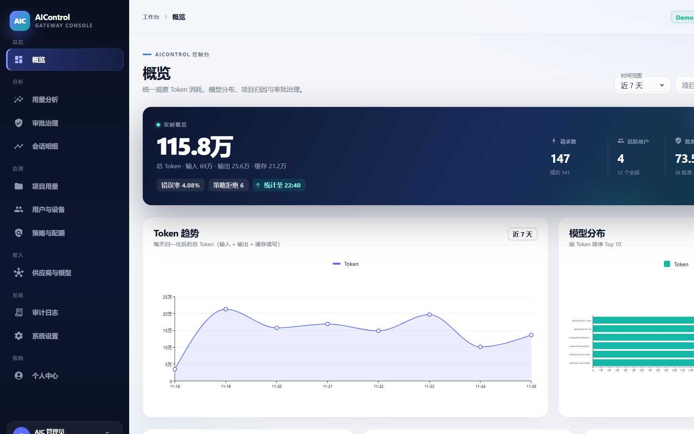
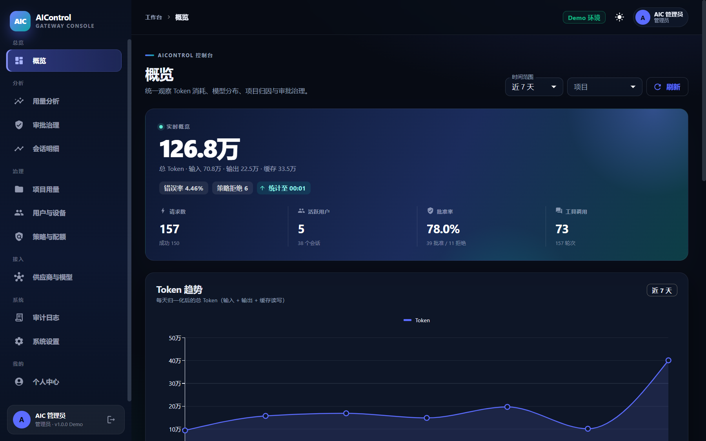
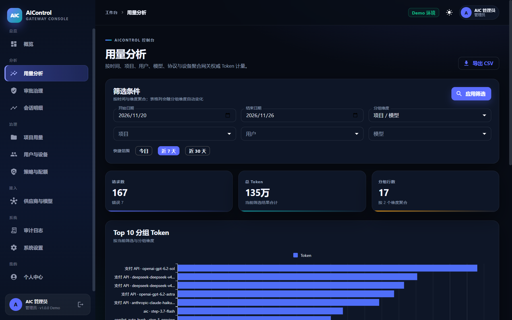
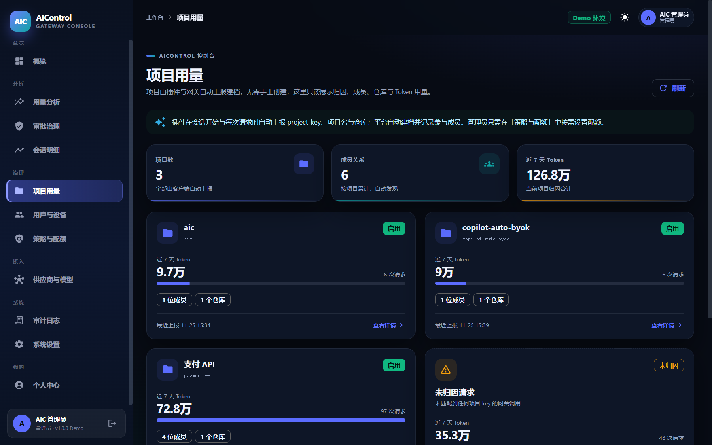
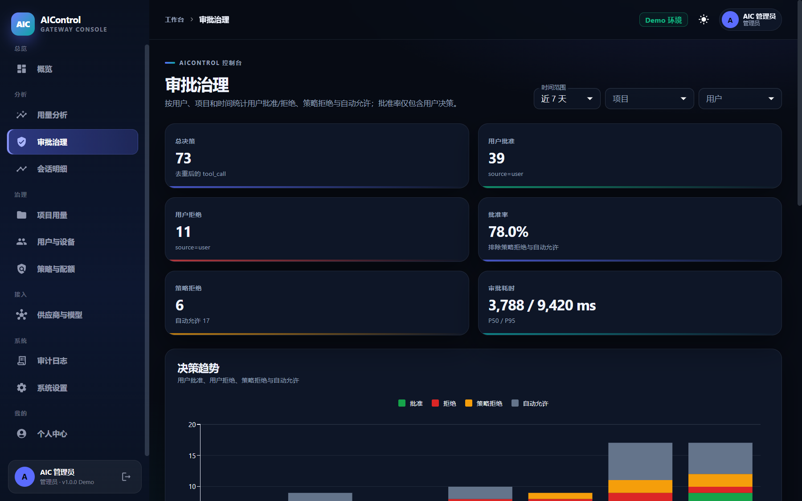
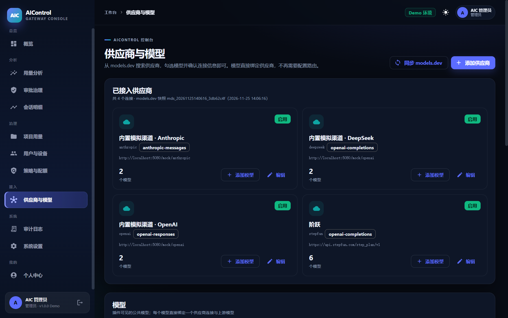
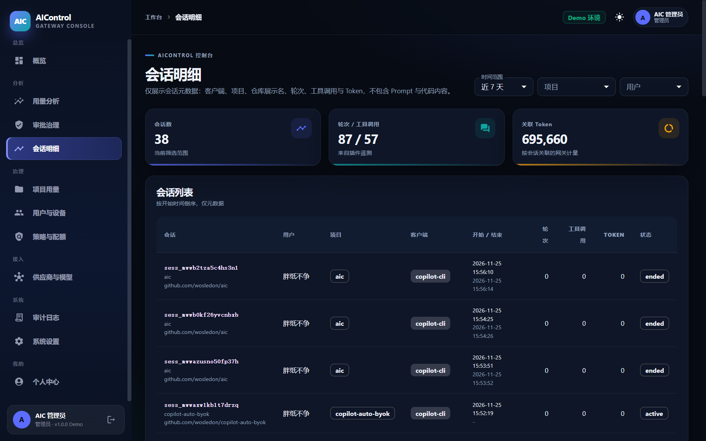
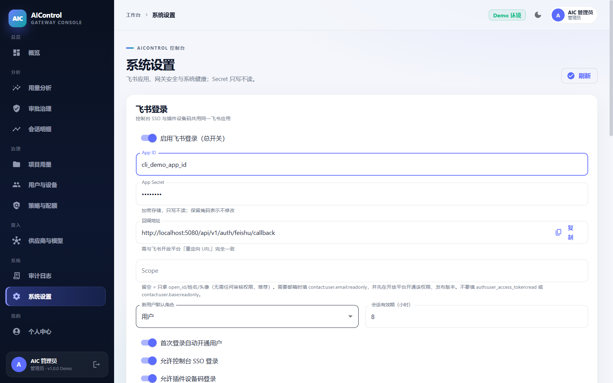
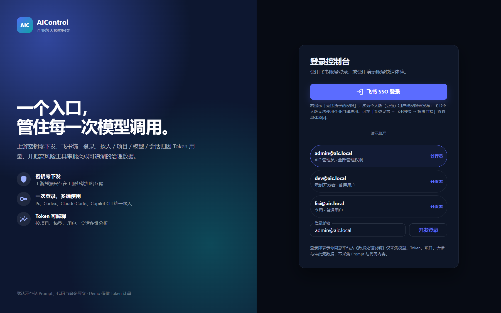
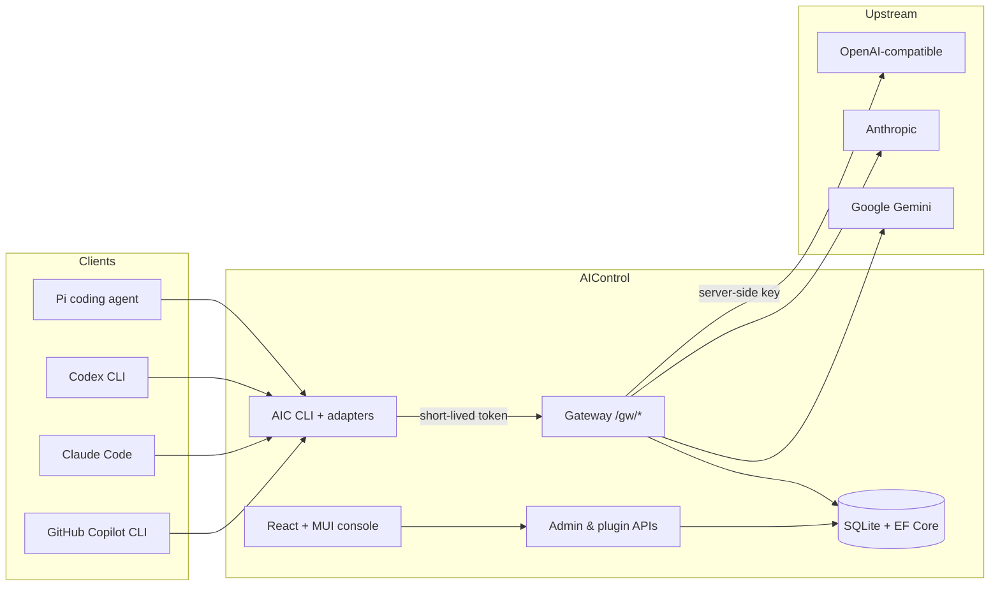

# AIControl

**English** | [简体中文](README.zh-CN.md)

> Enterprise LLM gateway demo: one endpoint for every coding agent, with per-project token analytics, approval governance, and zero provider keys on the client.

[](https://github.com/wosledon/aic/stargazers)
[](https://wosledon.github.io/aic/)
[](https://dotnet.microsoft.com/)
[](https://react.dev/)
[](#security-and-demo-scope)



<p align="center">
  <a href="https://wosledon.github.io/aic/"><strong>Live site</strong></a> ·
  <a href="#quick-start"><strong>Quick start</strong></a> ·
  <a href="docs/PRD.md"><strong>PRD</strong></a> ·
  <a href="docs/VERIFICATION.md"><strong>Verification log</strong></a> ·
  <a href="https://github.com/wosledon/aic"><strong>GitHub</strong></a>
</p>

---

## Why AIControl

### The gap: you can see the bill, not the work

An API key can tell you how many tokens were consumed. It cannot tell you **who** used them, **which project** they served, **which agent** ran the request, or **what kind of work** was performed. Locking everyone into a single tool is rarely the answer either — teams do their best work when they can choose the agent that fits the task.

AIControl closes that gap without standardizing on one client:

- **Keep the tools your team already uses.** Pi, Codex CLI, Claude Code and GitHub Copilot CLI connect through native adapters, not a replacement IDE.
- **Turn raw consumption into an audit trail.** Each request is attributed to a user, project, session, model and client, with tool-call and approval metadata captured at the edge.
- **Give people an identity, not a shared key.** Console SSO and CLI device-code login issue short-lived gateway tokens that can be revoked per person or device.
- **Keep provider credentials server-side.** Upstream base URLs and API keys never leave the gateway and are encrypted at rest.

### What is AIControl?

AIControl is a self-hosted **LLM gateway and AI usage audit platform** for engineering teams. It connects Pi, Codex CLI, Claude Code, GitHub Copilot CLI and any OpenAI-, Anthropic- or Google-compatible client to one governed endpoint, then turns raw token consumption into per-user, per-project, per-session and per-tool records — with unified identity, encrypted provider keys and approval telemetry.

## Features

| Capability                        | What it does                                                                                                                                   |
| --------------------------------- | ---------------------------------------------------------------------------------------------------------------------------------------------- |
| **Single model egress**           | OpenAI Chat Completions / Responses, Anthropic Messages, and Google Generative AI are proxied without protocol rewriting                       |
| **Provider + model catalog**      | Import providers and models from [models.dev](https://models.dev), bind a public model to exactly one upstream channel — no routing tables     |
| **Feishu SSO + device flow**      | Console SSO and CLI device-code login share one Feishu app; a dev login is available for local demos                                           |
| **Token analytics**               | Input, output, cache-read, and cache-write tokens are parsed from upstream usage and stored asynchronously                                     |
| **Automatic project attribution** | Plugins report project key, name, and Git repository; projects and memberships are created on first sight                                      |
| **Approval governance**           | Risk classification and approval gates in the plugin; approvals, denials, policy denials, and auto-allows are aggregated per user/project/tool |
| **Quotas & policies**             | Daily/monthly user and project quotas, model allowlists, approval rules, and rate-limit policies                                               |
| **Secret hygiene**                | AES-GCM at rest, write-only secrets, masked list responses, no prompt/code/command capture by default                                          |

## Screenshots

| Dashboard                                    | Token usage                          |
| -------------------------------------------- | ------------------------------------ |
|  |  |

| Projects                                   | Approvals                                    |
| ------------------------------------------ | -------------------------------------------- |
|  |  |

| Providers & models                     | Sessions                                   |
| -------------------------------------- | ------------------------------------------ |
|  |  |

| Settings                                   | Login                                |
| ------------------------------------------ | ------------------------------------ |
|  |  |

> The console UI is currently Simplified Chinese; the README and GitHub Pages site are bilingual.

## Architecture



## Quick start

**Prerequisites:** .NET 10 SDK, Node.js 20+, npm.

### 1. Backend

```powershell
dotnet run --project src/AIControl.Server --urls http://localhost:5080
```

The first run creates `aicontrol.db`, demo users, a demo project, mock provider channels, and a public model catalog from `.modelsdev.json`.

### 2. Frontend (development)

```powershell
cd frontend
npm install
npm run dev
```

Open `http://127.0.0.1:5173`. To serve the built console from the backend instead:

```powershell
cd frontend
npm run build:server
```

### 3. Sign in

- Open `http://localhost:5080` and use **开发登录** with `admin@aic.local`, or
- configure Feishu SSO under **系统设置 → 飞书登录**.

### 4. Install the CLI and connect a coding agent

```powershell
cd plugins/aic-gateway
npm install
npm run build
npm install -g .        # Windows: add --prefix "$env:APPDATA\npm" if needed

aic login               # device-code login (browser opens)
aic models              # list models available to your account
aic model set step-3.7-flash
aic-copilot             # or: aic-codex / aic-claude
```

`aic install pi|codex|claude|copilot` prints per-client wiring details. Pi loads the extension from the installed package automatically.

## Supported clients

| Client                 | Command       | Integration                                                                          |
| ---------------------- | ------------- | ------------------------------------------------------------------------------------ |
| **Pi coding agent**    | `pi`          | Pi extension (`pi.extensions`), provider registration, approval hooks                |
| **Codex CLI**          | `aic-codex`   | Injects a dedicated Codex profile with gateway base URL and headers                  |
| **Claude Code**        | `aic-claude`  | Injects `ANTHROPIC_BASE_URL` / token and approval hooks                              |
| **GitHub Copilot CLI** | `aic-copilot` | BYOK provider via `COPILOT_PROVIDER_*`, fresh token per request, attribution headers |

## Configuration

| Environment variable            | Purpose                                                                   |
| ------------------------------- | ------------------------------------------------------------------------- |
| `AIC_PUBLIC_BASE_URL`           | Public gateway URL (default `http://localhost:5080`)                      |
| `AIC_DB_CONNECTION`             | SQLite connection string or path                                          |
| `AIC_ENCRYPTION_KEY`            | AES-GCM key for provider/Feishu secrets — **required in non-Development** |
| `AIC_TOKEN_SIGNING_KEY`         | JWT signing key — **required in non-Development**                         |
| `AIC_DEV_LOGIN_ENABLED`         | Enable demo login (default `false`, `true` in Development config)         |
| `AIC_SEED_DEMO`                 | Seed demo data                                                            |
| `AIC_BOOTSTRAP_ADMIN_UNION_IDS` | Bootstrap admin union IDs (comma separated)                               |
| `AIC_HOME`                      | CLI state directory (default `~/.aic`)                                    |
| `AIC_PROJECT`                   | Override the reported project key                                         |

Secrets such as Feishu App Secret and provider API keys are entered in the console and encrypted at rest. Never commit `.env`, `appsettings.Development.json`, `*.db`, `wwwroot/`, or `~/.aic`.

## Security and demo scope

- Provider keys are write-only: APIs return masks only; logs redact secrets.
- Gateway tokens are short-lived; refresh tokens are hashed, rotated, and reuse-detected.
- No prompts, completions, code, file contents, or command text are stored by default.
- Approvals are **governance and audit**, not a tamper-proof enforcement boundary; hard limits come from model allowlists, quotas, key isolation, and network policy.
- This repository is an evaluation demo, not a production-hardened distribution.

## Repository layout

```text
src/AIControl.Domain/          Entities and enums
src/AIControl.Infrastructure/  EF Core, SQLite, crypto, catalog sync, telemetry, analytics
src/AIControl.Server/          Minimal APIs, gateway proxy, admin APIs, static hosting
frontend/                      React + TypeScript + MUI console
plugins/aic-gateway/           AIC CLI, Pi extension, Codex/Claude/Copilot adapters
tests/AIControl.UnitTests/     Unit tests
docs/                          PRD, UI spec, verification log, GitHub Pages
```

## Documentation

- [Product requirements](docs/PRD.md)
- [UI and design system](docs/UI.md)
- [Verification log](docs/VERIFICATION.md)
- [Plugin guide](plugins/aic-gateway/README.md)
- [Bilingual project site](https://wosledon.github.io/aic/)

## Star the project

If AIControl is useful or interesting, a star helps others find it:

[](https://github.com/wosledon/aic/stargazers)

<p align="center">
  <a href="https://github.com/wosledon/aic"><strong>⭐ Star on GitHub</strong></a> ·
  <a href="https://wosledon.github.io/aic/?lang=zh"><strong>中文介绍</strong></a>
</p>

## Contact

Questions, ideas or issues: [powertle@outlook.com](mailto:powertle@outlook.com).