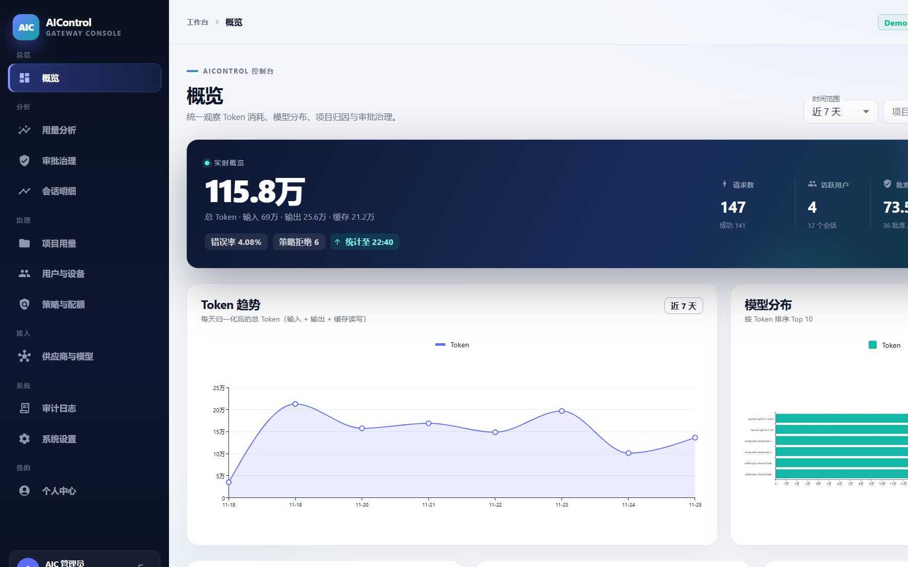
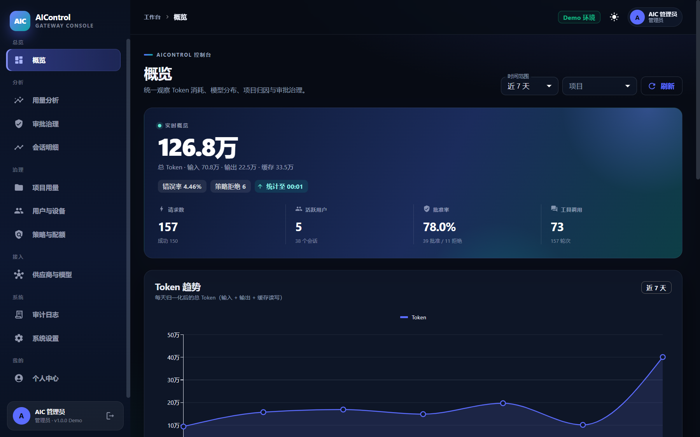
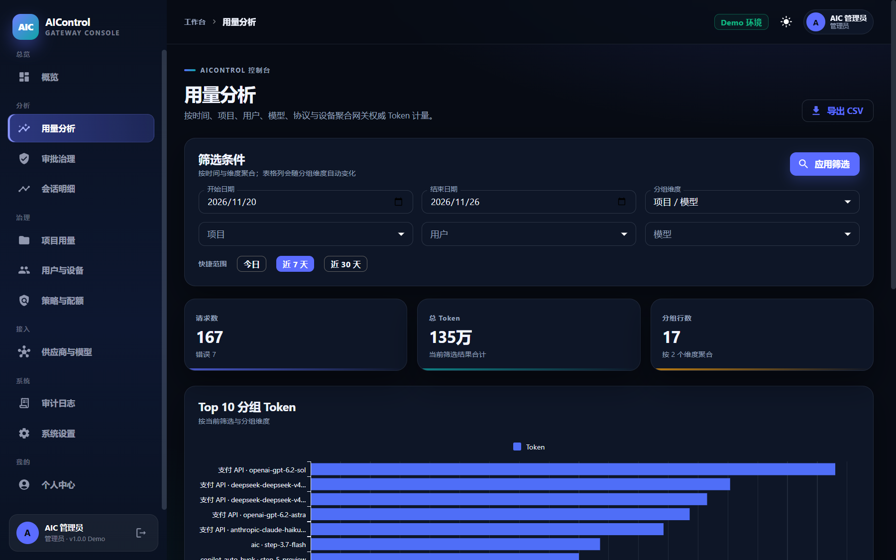
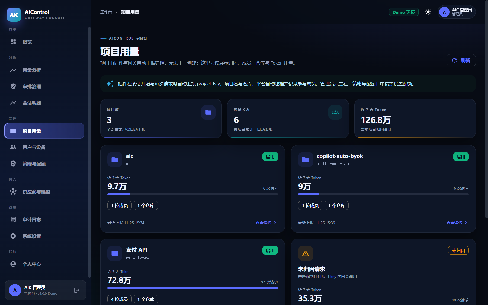
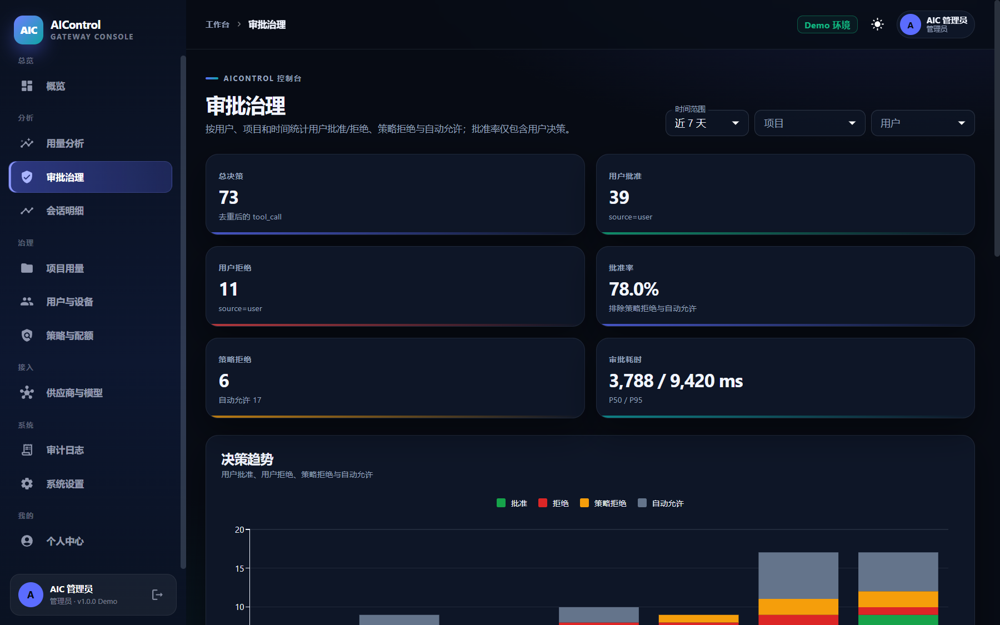
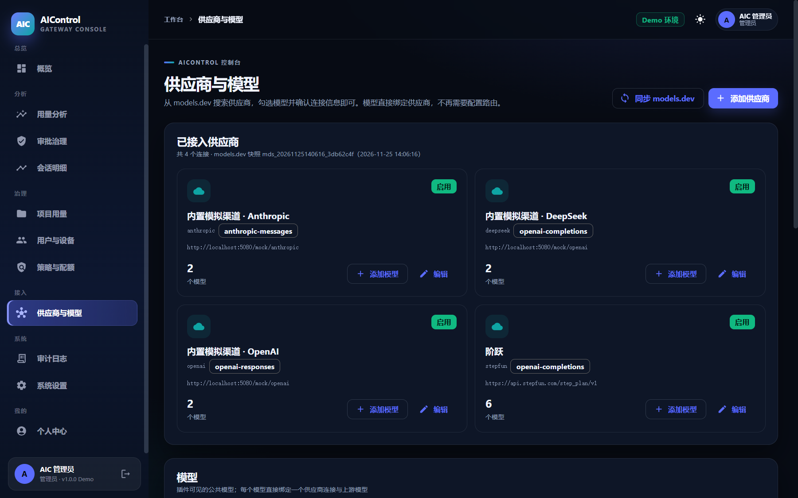
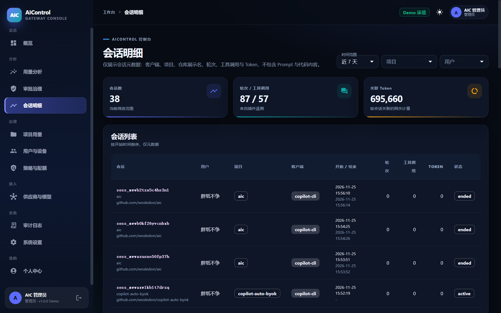
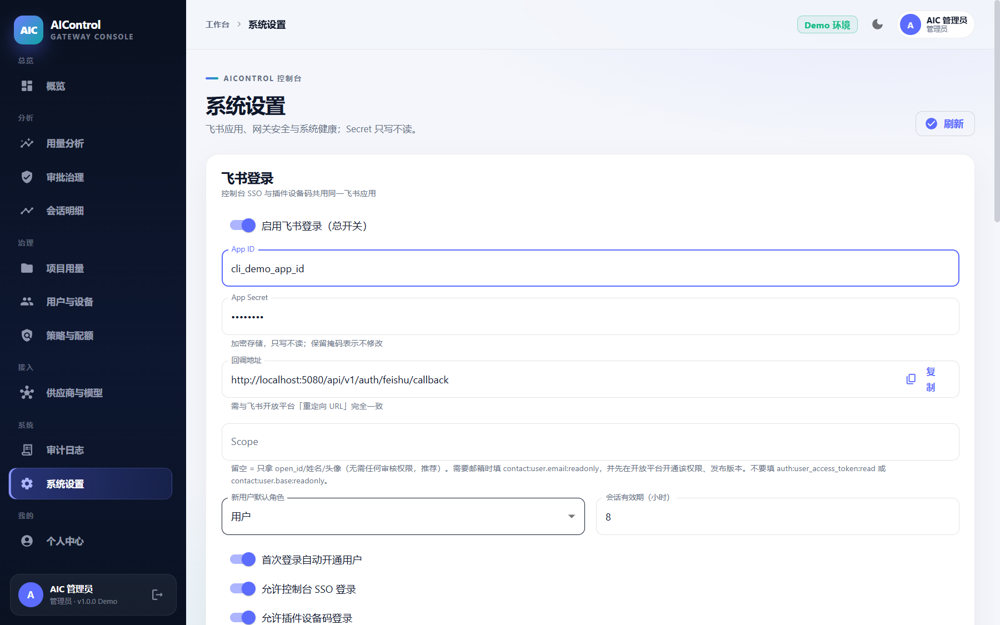
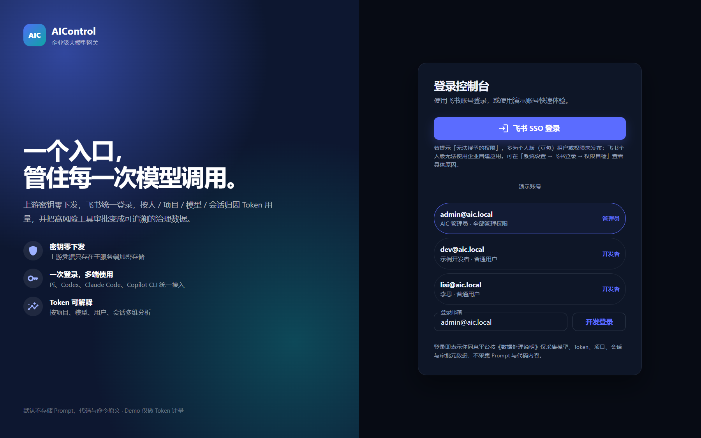
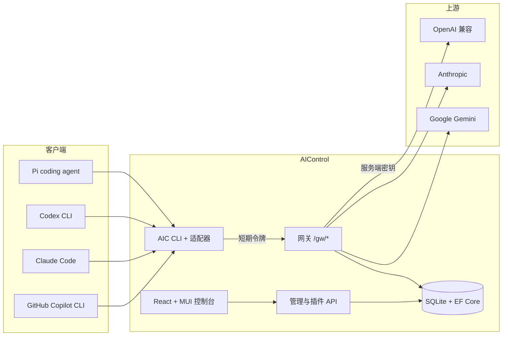

# AIControl

[English](README.md) | **简体中文**

> 企业级大模型网关 Demo：为所有编码 Agent 提供统一出口，按项目归因 Token、治理工具审批，客户端不持有任何上游密钥。

> ⭐ **如果 AIControl 对你有帮助，欢迎[点个 Star](https://github.com/wosledon/aic/stargazers)。** 这会让更多团队发现这个项目，谢谢支持！

[](https://github.com/wosledon/aic/stargazers)
[](https://github.com/wosledon/aic)
[](https://wosledon.github.io/aic/?lang=zh)
[](https://dotnet.microsoft.com/)
[](https://react.dev/)
[](#安全与-demo-边界)



<p align="center">
  <a href="https://wosledon.github.io/aic/?lang=zh"><strong>项目主页</strong></a> ·
  <a href="#快速开始"><strong>快速开始</strong></a> ·
  <a href="docs/PRD.md"><strong>PRD</strong></a> ·
  <a href="docs/VERIFICATION.md"><strong>验证记录</strong></a> ·
  <a href="https://github.com/wosledon/aic"><strong>GitHub</strong></a> ·
  <a href="https://github.com/wosledon/aic/stargazers"><strong>⭐ 点 Star</strong></a>
</p>

---

## 为什么需要 AIControl

### 缺口：看得见账单，看不见用法

一把 API Key 能回答「用了多少 Token」，却回答不了「谁在用、用在哪一个项目、用的是哪个 Agent、做了什么类型的工作」。而强制所有人使用同一种工具，也往往不是答案——团队在能自由选择合适 Agent 时，效率才是最高的。

AIControl 用「统一身份 + 统一埋点」补上这段空白，同时不限制团队使用哪种工具：

- **保留团队已经顺手的工具。** Pi、Codex CLI、Claude Code、GitHub Copilot CLI 通过原生适配器接入，而不是替换工作方式。
- **把原始消耗变成可审计的记录。** 每次请求归因到用户、项目、会话、模型与客户端，并在边缘采集工具调用与审批元数据。
- **给人一个身份，而不是共享一把密钥。** 控制台 SSO 与 CLI 设备码签发短期网关令牌，可按人或设备随时撤销。
- **上游凭据留在服务端。** Base URL 与 API Key 不离开网关，并加密存储。

### AIControl 是什么？

AIControl 是面向工程团队的自托管 **LLM 网关与 AI 使用审计平台**。它把 Pi、Codex CLI、Claude Code、GitHub Copilot CLI 以及任意 OpenAI / Anthropic / Google 兼容客户端接到同一个受治理入口，将原始 Token 消耗转化为按用户、项目、会话与工具的记录，并提供统一身份、加密上游密钥与审批遥测。

## 功能概览

| 能力                  | 说明                                                                                     |
| --------------------- | ---------------------------------------------------------------------------------------- |
| **唯一模型出口**      | OpenAI Chat Completions / Responses、Anthropic Messages、Google Generative AI 原协议代理 |
| **供应商 + 模型目录** | 从 [models.dev](https://models.dev) 导入供应商与模型，公共模型直连一个上游通道，无路由表 |
| **飞书 SSO + 设备码** | 控制台 SSO 与 CLI 设备码共用同一飞书应用；本地 Demo 提供开发登录                         |
| **Token 计量**        | 解析上游 usage 的输入 / 输出 / 缓存读写 Token，异步入库                                  |
| **项目自动上报**      | 插件上报项目 key、名称与 Git 仓库，平台首次见到即自动建档并记录成员                      |
| **审批治理**          | 插件侧风险分类与审批门禁，按用户 / 项目 / 工具统计批准、拒绝、策略拒绝与自动允许         |
| **配额与策略**        | 用户 / 项目日 / 月配额、模型白名单、审批规则、速率策略                                   |
| **密钥安全**          | AES-GCM 静态加密、只写不读、列表仅返回掩码；默认不采集 Prompt / 代码 / 命令原文          |

## 页面截图

| 概览                                    | 用量分析                            |
| --------------------------------------- | ----------------------------------- |
|  |  |

| 项目用量                               | 审批治理                                |
| -------------------------------------- | --------------------------------------- |
|  |  |

| 供应商与模型                         | 会话明细                               |
| ------------------------------------ | -------------------------------------- |
|  |  |

| 系统设置                               | 登录                                |
| -------------------------------------- | ----------------------------------- |
|  |  |

## 架构



## 快速开始

**环境要求：** .NET 10 SDK、Node.js 20+、npm。

### 1. 启动后端

```powershell
dotnet run --project src/AIControl.Server --urls http://localhost:5080
```

首次启动会创建 `aicontrol.db`、演示用户、演示项目、模拟供应商连接，并从 `.modelsdev.json` 导入公共模型目录。

### 2. 启动前端（开发模式）

```powershell
cd frontend
npm install
npm run dev
```

打开 `http://127.0.0.1:5173`。如果希望由后端直接托管构建产物：

```powershell
cd frontend
npm run build:server
```

### 3. 登录

- 打开 `http://localhost:5080`，用**开发登录** `admin@aic.local`，或
- 在「系统设置 → 飞书登录」配置飞书 SSO。

### 4. 安装 CLI 并接入编码 Agent

```powershell
cd plugins/aic-gateway
npm install
npm run build
npm install -g .        # Windows 如权限不足：加 --prefix "$env:APPDATA\npm"

aic login               # 设备码登录（会自动打开浏览器）
aic models              # 查看当前账号可用模型
aic model set step-3.7-flash
aic-copilot             # 或 aic-codex / aic-claude
```

`aic install pi|codex|claude|copilot` 会输出各客户端的接入说明；Pi 安装后会自动加载扩展。

## 支持的客户端

| 客户端                 | 命令          | 接入方式                                                |
| ---------------------- | ------------- | ------------------------------------------------------- |
| **Pi coding agent**    | `pi`          | Pi 扩展（`pi.extensions`）、Provider 注册、审批钩子     |
| **Codex CLI**          | `aic-codex`   | 注入 Codex profile（网关 Base URL 与归因头）            |
| **Claude Code**        | `aic-claude`  | 注入 `ANTHROPIC_BASE_URL` / Token 与审批钩子            |
| **GitHub Copilot CLI** | `aic-copilot` | `COPILOT_PROVIDER_*` BYOK，每条请求刷新令牌并注入归因头 |

## 配置项

| 环境变量                        | 用途                                                        |
| ------------------------------- | ----------------------------------------------------------- |
| `AIC_PUBLIC_BASE_URL`           | 网关对外地址（默认 `http://localhost:5080`）                |
| `AIC_DB_CONNECTION`             | SQLite 连接串或路径                                         |
| `AIC_ENCRYPTION_KEY`            | 渠道 / 飞书密钥的 AES-GCM 密钥，**非 Development 必填**     |
| `AIC_TOKEN_SIGNING_KEY`         | JWT 签名密钥，**非 Development 必填**                       |
| `AIC_DEV_LOGIN_ENABLED`         | 是否启用演示登录（默认 `false`，Development 配置为 `true`） |
| `AIC_SEED_DEMO`                 | 是否初始化演示数据                                          |
| `AIC_BOOTSTRAP_ADMIN_UNION_IDS` | 初始管理员 union_id（逗号分隔）                             |
| `AIC_HOME`                      | CLI 配置目录（默认 `~/.aic`）                               |
| `AIC_PROJECT`                   | 覆盖当前上报的项目 key                                      |

飞书 App Secret、供应商 API Key 在控制台录入并加密存储。不要提交 `.env`、`appsettings.Development.json`、`*.db`、`wwwroot/` 或 `~/.aic`。

## 安全与 Demo 边界

- 上游密钥只写不读，接口仅返回掩码，日志脱敏。
- 网关令牌短期有效；refresh token 哈希存储、轮换并检测重用。
- 默认不采集 Prompt、补全、代码、文件内容与命令原文。
- 审批是**治理与记录能力**，不是防篡改的强制边界；硬控制由模型白名单、配额、密钥隔离与网络策略执行。
- 本仓库是用于评估的 Demo，不是生产加固发行版。

## 目录结构

```text
src/AIControl.Domain/          领域实体与枚举
src/AIControl.Infrastructure/  EF Core、SQLite、加解密、目录同步、计量、遥测、分析
src/AIControl.Server/          Minimal API、网关代理、管理 API、静态站点托管
frontend/                      React + TypeScript + MUI 控制台
plugins/aic-gateway/           AIC CLI、Pi 扩展、Codex / Claude / Copilot 适配器
tests/AIControl.UnitTests/     单元测试
docs/                          PRD、UI 规范、验证记录、GitHub Pages
```

## 文档

- [产品需求](docs/PRD.md)
- [UI 与设计系统](docs/UI.md)
- [验证记录](docs/VERIFICATION.md)
- [插件指南](plugins/aic-gateway/README.md)
- [中英双语项目主页](https://wosledon.github.io/aic/?lang=zh)

## 点个 Star

如果 AIControl 对你有帮助，欢迎点 Star：

[](https://github.com/wosledon/aic/stargazers)

<p align="center">
  <a href="https://github.com/wosledon/aic"><strong>⭐ 在 GitHub 点 Star</strong></a> ·
  <a href="https://wosledon.github.io/aic/"><strong>English site</strong></a>
</p>

## 联系

问题、建议或合作：[powertle@outlook.com](mailto:powertle@outlook.com)。