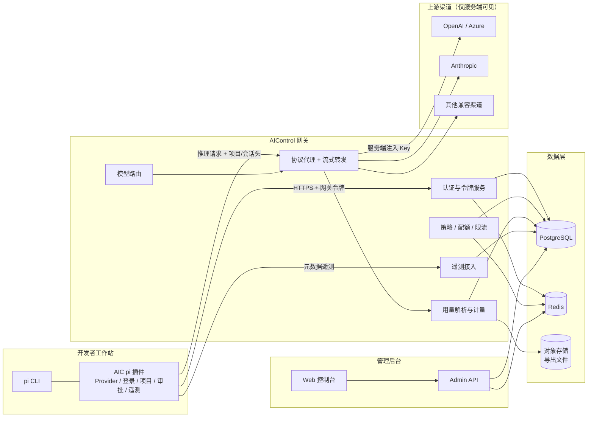
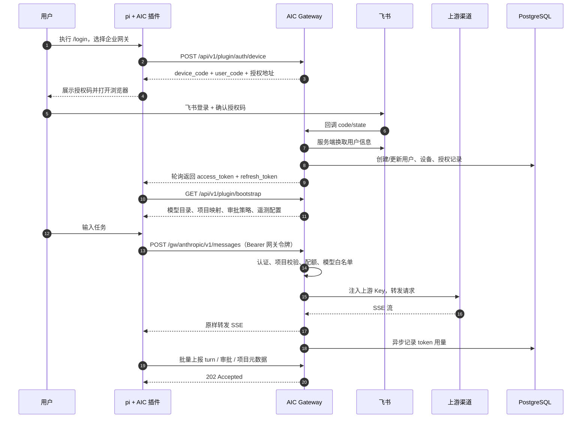
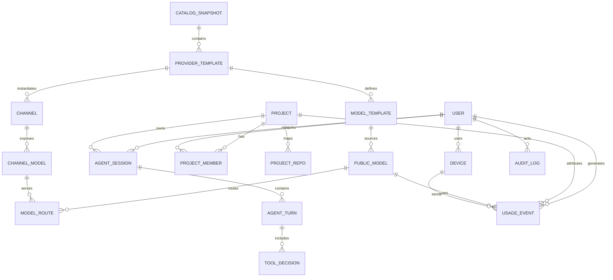
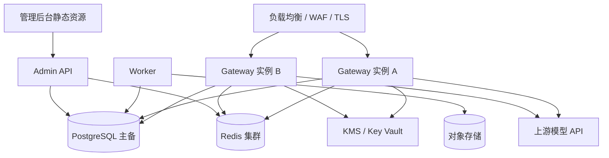

# AIControl 大模型网关 PRD

| 项目 | 内容 |
|---|---|
| 文档名称 | AIControl 大模型网关产品需求文档 |
| 版本 | v0.2（Demo 简化版） |
| 日期 | 2026-11-25 |
| 状态 | 待评审 |
| 关联仓库 | `E:/repos/aic` |
| 目标读者 | 产品、架构、后端、前端、插件开发、测试、安全、运维 |

> 说明：仓库中实际存在的文档目录为 `docs/`，本文档位于 `docs/PRD.md`。
>
> Demo 简化决策：只保留**管理员/用户**两级角色；单实例部署，不建租户、部门或组织架构；models.dev 只用于供应商/模型/上下文/推理强度模板；只做 **token 计量**，不做计费、价格、币种或账单。

---

## 1. 背景与问题

团队在日常研发中使用 Pi coding agent 等 AI 编程工具。当前通常采用以下方式接入模型：

- 每个开发者自行申请或共享上游模型 API Key；
- 在本地配置上游 `base_url`、`api_key`，或使用多个第三方客户端；
- 无法统一控制模型范围、额度、并发和 token 用量；
- 无法知道 token 花在哪个项目、哪个模型上；
- 无法统计用户在 AI 辅助过程中批准/拒绝了哪些高风险操作；
- 上游密钥分散在个人电脑、脚本和聊天记录中，存在泄漏风险；
- 人员离职或项目结束后，密钥难以及时回收。

因此需要建设一个企业级大模型网关 AIControl：

1. 所有模型请求统一经过网关，上游渠道的 `base_url` 和 `api_key` 只存在于服务端；
2. 开发者通过飞书身份登录 Pi 插件后即可使用，不接触任何上游密钥；
3. 平台统一配置飞书登录、模型渠道、路由、配额和审批策略；
4. 平台按用户、项目、模型、时间等维度分析 token 用量；
5. Pi 插件上报项目归属、会话、工具调用及用户批准/拒绝事件，形成可解释的研发效能与治理数据。

### 1.1 当前痛点

| 痛点 | 影响 |
|---|---|
| 密钥分散 | 泄漏后难以发现和回收；无法审计谁在何时使用了哪个模型 |
| 渠道不透明 | 不知道实际调用的是哪个上游、哪个模型、消耗了多少 token |
| 用量不可归因 | 无法按项目做 token 分摊和配额控制 |
| 缺少治理 | 高风险命令没有统一的审批口径和记录 |
| 缺少使用数据 | 无法评估 AI 编程工具的实际采用率、效率和风险 |
| 登录体验割裂 | 每个工具单独配置账号、Key、Base URL |

### 1.2 机会

- 以飞书作为唯一身份源，打通“人-项目-模型使用”数据；
- 以 Pi 插件作为受控入口，把项目上下文和审批决策带入网关；
- 以网关作为唯一模型出口，实现密钥零下发、配额硬控制、统一审计；
- 复用 [models.dev](https://models.dev) 开放目录作为供应商、模型和推理强度模板，减少手工维护；
- 在不采集 prompt/代码内容的前提下，仍能提供有价值的用量和治理分析。

---

## 2. 产品目标与非目标

### 2.1 产品目标

#### G1. 唯一模型出口，密钥零下发

- 客户端只能拿到网关地址和短期网关令牌；
- 上游渠道的 `base_url`、`api_key`、附加认证头只存储在服务端；
- 任何接口、错误信息、日志、插件配置、模型元数据都不得返回上游密钥；
- 上游错误信息统一脱敏，避免通过报错泄露渠道地址。

#### G2. 飞书统一登录

- 平台管理员在后台配置飞书应用（App ID、App Secret、回调地址、Scope）；
- 管理后台使用飞书网页 SSO；
- Pi 插件使用网关实现的“设备码 + 浏览器授权”流程完成飞书登录；
- 登录成功后由网关签发短期访问令牌和可轮换刷新令牌；
- 支持按飞书用户自动开通、停用；新用户默认为普通用户，管理员可在后台调整。

#### G3. Pi agent 无缝接入

- 通过 Pi 扩展注册一个受控 Provider，模型列表由平台下发；
- 用户在 Pi 中执行 `/login` 选择企业网关，浏览器完成飞书登录后即可使用；
- 插件不要求用户填写 `base_url` 或 `api_key`；
- 插件自动识别当前工作项目并上报，支持手动切换；
- 插件提供审批门禁，记录用户批准/拒绝行为；
- 插件离线时请求失败但审批和遥测可本地排队，恢复后补报。

#### G4. 多维用量分析

- 按用户、项目、仓库、模型、协议、渠道、设备、插件版本、时间等维度分析；
- 指标包括请求数、输入/输出/缓存 token、总 token、延迟、错误率、会话数、轮次数等；
- 只做 token 计量，不做费用、计费、币种或汇率；
- 支持按项目查看 token 排名、趋势、Top 用户；
- 支持批准/拒绝次数、批准率、拒绝工具分布、审批耗时；
- 支持 CSV/Excel 导出和定时报表（定时报表为 P1）。

#### G5. 治理与可控

- 模型白名单、用户/项目配额、速率限制；
- 高风险工具审批策略；
- 管理员操作审计；
- 用户离职、令牌泄漏、渠道故障可快速处置；
- 默认不存储 prompt、补全内容和代码，仅存储元数据。

### 2.2 非目标（v1 不做）

| 非目标 | 说明 |
|---|---|
| 公开售卖 API Key | 不向个人或外部客户发放可直接调用上游的 Key |
| 模型训练/微调平台 | 不做训练、数据集管理 |
| 完整 DLP/内容审核 | v1 不扫描 prompt 内容；可作为后续独立能力 |
| 通用 API 网关 | 只处理 LLM 推理协议和必要的管理 API |
| 模型托管 | 不部署模型，只代理到上游渠道 |
| 端到端不可绕过的审批 | 客户端插件运行在用户机器上，审批是治理与记录能力，不是防篡改的强制安全边界；硬隔离需受控运行环境（见 §13） |
| 计费/账单/收款 | demo 只做 token 计量，不做费用计算、账单、收款、发票、币种或汇率 |
| 多租户/组织架构 | 不建租户、部门、组织树；只保留用户、项目、模型和用量 |
| 多 Region 容灾（v1） | 先支持单 Region 双活实例，跨 Region 作为后续演进 |

### 2.3 成功指标

| 指标 | 目标（上线 3 个月） |
|---|---|
| AI 编程请求经网关比例 | ≥ 90% |
| 上游密钥暴露事件 | 0 |
| 飞书登录成功率 | ≥ 99%（排除用户取消） |
| 项目归因覆盖率 | ≥ 95% 的会话可归因到项目或明确标记“未归因” |
| Token 统计与网关计量一致 | 100%（估算项单独标记） |
| 审批事件上报成功率 | ≥ 99%（联网状态下） |
| 管理员配置渠道到可用 | ≤ 10 分钟 |
| 网关新增延迟 P95 | ≤ 50 ms（不含上游耗时） |

---

## 3. 用户与角色

Demo 固定为**管理员/用户**两级角色，不实现更细粒度权限。

| 角色 | 典型用户 | 核心诉求 | 权限 |
|---|---|---|---|
| 管理员 | IT/平台团队 | 配置飞书、渠道、模型、项目、配额和审批策略 | 全部管理权限；查看全量用量、审批和审计；管理用户与设备 |
| 用户 | 普通开发者 | 登录即用、切换项目、查看自己的用量 | 通过 Pi 插件使用模型；查看本人用量、本人设备和本人会话；无管理后台权限 |

> 管理员也可以作为普通用户使用 Pi。管理员与用户之间的变更由管理员在后台操作，并写入审计日志。Demo 不建组织架构，只保留用户、项目和项目成员关系；项目成员关系仅用于归因校验，不构成额外角色。

### 3.1 关键用户故事

- **US-01**：作为用户，我在新电脑安装 Pi 插件后，只需执行 `/login` 并用飞书扫码/登录，就能选择企业模型开始工作，不需要申请或填写任何上游 Key。
- **US-02**：作为用户，我在仓库 A 中工作时，插件自动把本次会话归因到项目 A；切换仓库后归因自动变化，也可用 `/aic-project` 手动更正。
- **US-03**：作为用户，当模型试图执行高风险命令时，我在 Pi 中看到审批提示；我选择拒绝后命令不执行，平台记录一次拒绝。
- **US-04**：作为管理员，我在后台看到项目 A 本周消耗的 token、Top 用户、模型分布和审批拒绝情况。
- **US-05**：作为管理员，我在后台配置 Anthropic/OpenAI/Azure 等渠道，设置模型别名和路由，不需要把渠道信息发给任何开发者。
- **US-06**：作为管理员，我可以追溯某次会话使用了哪个模型、多少 token、用户批准/拒绝了哪些工具调用，但看不到 prompt 和代码内容。
- **US-07**：作为管理员，当某用户离职时，我在后台停用其账号，其刷新令牌立即失效，所有设备在下一次请求时被拒绝。

---

## 4. 术语

| 术语 | 定义 |
|---|---|
| 网关 / Gateway | AIControl 对客户端暴露的统一模型入口，负责认证、策略、路由、代理、计量 |
| 上游渠道 / Channel | 实际提供模型服务的上游，如 OpenAI、Anthropic、Azure OpenAI、火山引擎等 |
| 公共模型 / Public Model | 网关对客户端暴露的模型别名，如 `claude-sonnet-4-5`、`gpt-5-codex` |
| 渠道模型 / Channel Model | 上游真实模型 ID，如 `claude-sonnet-4-5-20250929` |
| 项目 / Project | 平台中的用量与治理单元，可绑定一个或多个代码仓库 |
| 会话 / Session | Pi 的一次会话（session file），可包含多个 turn |
| Turn | 一次模型请求及其触发的工具调用 |
| 审批 / Approval | 插件在工具执行前向用户发起的允许/拒绝确认 |
| 遥测 / Telemetry | 插件上报的会话、项目、轮次、审批等元数据，不包含 prompt 内容 |
| 网关令牌 | 网关签发的短期访问令牌，只能访问网关，不是上游 API Key |
| models.dev | 开放的供应商/模型目录，提供模型能力、上下文限制和推理强度元数据（MIT） |
| 供应商模板 | 从 models.dev 导入的供应商标识、协议建议、上游地址（仅管理员可见）和模型集合 |
| 推理强度 | 模型支持的 thinking/effort 档位，如 `low`/`medium`/`high`/`xhigh`/`max`，映射为 Pi 的 thinking level |
| Token 用量 | 一次请求或一个周期内的输入/输出/缓存 token 数，是 demo 的核心计量口径 |

---

## 5. 总体方案

### 5.1 架构原则

1. **唯一出口**：开发者侧只访问网关，不直接访问任何上游模型服务。
2. **密钥零下发**：上游渠道凭据只存在于服务端加密存储和运行时内存。
3. **协议保持**：网关尽量做“透明代理 + 策略”，不在 v1 做复杂的跨协议转换，降低工具调用、流式、思考块等兼容风险。
4. **服务端权威计量**：token 以网关从上游响应中解析的结果为准；插件上报只用于项目、审批、会话等补充维度。
5. **最小化采集**：默认只采集元数据，不采集 prompt、补全、代码、文件内容。
6. **客户端不可信**：插件上报和审批记录用于治理分析，不用于硬安全控制；配额、模型权限、密钥保护由网关强制执行。
7. **可演进**：先模块化单体，再按流量拆分代理层、分析层和异步 Worker。

### 5.2 逻辑架构



> models.dev 只由目录同步 Worker 访问，推理链路不依赖它；同步结果以快照落库，外部目录不可用时使用上一个可用快照。

### 5.3 请求链路



### 5.4 技术选型建议

| 层 | 建议 | 理由 |
|---|---|---|
| 网关/控制面 | ASP.NET Core（.NET 11，按团队 LTS 策略定稿） | 仓库已有 `.slnx`，适合高性能反向代理、认证、策略 |
| 代理实现 | YARP + 自定义中间件/`HttpClient` 流式转发 | 成熟的转发能力，便于做逐请求策略和 SSE |
| 管理后台 | React + TypeScript + 组件库 | 与插件共享 TS 类型；图表生态成熟 |
| 数据库 | PostgreSQL 16+ | 事务、JSONB、分区、物化视图；MVP 足够 |
| 缓存/限流 | Redis 7+ | 分布式限流、令牌状态、分布式锁 |
| 异步任务 | 后台 Worker + Outbox | 用量落库、报表导出、告警、models.dev 同步 |
| 模板同步 | 后台 Worker + JSON Schema 校验 + 版本存储 | 从 models.dev 导入供应商、模型和推理强度；运行时不依赖外部目录 |
| 可观测性 | OpenTelemetry + Prometheus + 结构化日志 | 请求链路、指标、告警统一 |
| Pi 插件 | TypeScript + Pi Extension API | `registerProvider` / `oauth` / 事件钩子 |
| 密钥管理 | KMS/Key Vault + 信封加密 | 渠道密钥和飞书 Secret 加密存储 |

### 5.5 建议仓库结构

```text
AIControl.slnx
src/
  AIControl.Gateway/          # 网关、认证、代理、遥测接入
  AIControl.Admin/            # 管理 API（可与 Gateway 同进程，模块化拆分）
  AIControl.Domain/           # 实体、策略、领域服务
  AIControl.Infrastructure/   # EF Core、Redis、加密、外部客户端
  AIControl.Worker/           # 异步计量、导出、告警、models.dev 同步
frontend/
  admin/                      # 管理控制台
plugins/
  pi-aic-gateway/             # Pi 插件（npm 包）
tests/
  AIControl.UnitTests/
  AIControl.IntegrationTests/
  AIControl.E2ETests/
docs/
  PRD.md
```

### 5.6 方案对比

| 方案 | 优点 | 缺点 | 适用性 |
|---|---|---|---|
| 纯自建（ASP.NET Core + 协议代理） | 飞书、Pi 插件、审批和归因深度定制；数据自主；与现有 .NET 仓库一致 | 开发量大；流式/协议兼容需要测试积累 | **推荐作为主方案** |
| LiteLLM / Portkey 等开源/商业网关 | 渠道接入、路由能力成熟；上线快 | 飞书原生登录、Pi 插件审批/项目归因仍需自研；技术栈和数据边界多一层 | 可作为渠道适配或过渡，不作为最终控制面 |
| 云厂商 AI Gateway | 免运维；与云网络集成 | 数据出境/密钥托管/飞书身份集成受限；定制审批困难 | 仅适合作为部分渠道的上游 |
| 直接发 API Key + 各自配置 | 无开发成本 | 无法统一治理、无法归因、密钥分散 | 不满足目标 |

**结论**：自建“认证 + 策略 + 计量 + 管理面”，协议代理优先复用 YARP/HttpClient 和成熟 SDK；渠道接入层可在需要时评估 LiteLLM，但不把核心身份、密钥和治理数据交给外部网关。

---

## 6. 关键设计决策

### D1. 协议保持代理，而不是统一翻译

**决策**：网关按上游协议暴露路径，例如：

- `POST /gw/anthropic/v1/messages`
- `POST /gw/openai/v1/responses`
- `POST /gw/openai/v1/chat/completions`
- `POST /gw/google/v1beta/models/{model}:streamGenerateContent`

Pi 插件为每个公共模型声明对应的 `api` 和网关路径，由 Pi 内置协议实现负责序列化。模型级 `baseUrl` 必须按 Pi/SDK 的路径拼接习惯配置：

| 协议 | 模型 `baseUrl` 示例 | Pi 最终请求路径 |
|---|---|---|
| Anthropic Messages | `https://gw.aic.example.com/gw/anthropic` | `/gw/anthropic/v1/messages` |
| OpenAI Responses | `https://gw.aic.example.com/gw/openai/v1` | `/gw/openai/v1/responses` |
| OpenAI Chat Completions | `https://gw.aic.example.com/gw/openai/v1` | `/gw/openai/v1/chat/completions` |
| Google Generative AI | `https://gw.aic.example.com/gw/google/v1beta` | `/gw/google/v1beta/models/...` |

**理由**：

- Pi 的 tool call、reasoning/thinking、图片、缓存、流式事件对协议细节敏感；
- 跨协议翻译容易破坏工具调用、思考块和缓存 token 解析；
- 保持协议可以让网关专注于认证、策略、路由、计量；
- 上游渠道只要协议一致即可接入，Azure OpenAI 等差异通过适配器处理。

**代价**：同一模型可能需要按协议暴露一次；平台需要维护协议类型字段。

### D2. 客户端只拿网关令牌，不拿上游凭据

**决策**：

- 飞书登录成功后，网关签发短期 JWT access token（默认 15 分钟）和刷新令牌（默认 30 天，轮换）；
- access token 仅能被网关验签，不能用于上游；
- 渠道 `base_url`、`api_key`、自定义认证头加密存储，只在网关请求上游时解密；
- 管理后台对密钥字段只写不读，列表只返回掩码；
- 网关返回错误时统一错误体和脱敏 message，不透传上游原始错误头/URL。

**边界说明**：网关地址本身对客户端是可见的（网络请求必然可见），它不是秘密；真正的秘密是上游渠道凭据和可越权的令牌。产品要求中的“不暴露 base_url/API Key”指上游渠道信息，而不是网关入口地址。

### D3. 双来源数据：网关权威计量 + 插件补充归因

| 数据 | 来源 | 权威性 | 用途 |
|---|---|---|---|
| 请求数、token、延迟、状态码 | 网关解析上游响应 | 权威 | 配额、用量分析 |
| 项目、会话、turn、工具调用、审批 | 插件遥测 | 补充/自报 | 项目归因、研发效能、治理分析 |
| 用户、角色 | 飞书登录 + 平台 | 权威 | 身份与权限（仅管理员/用户） |

**理由**：插件运行在用户机器上，数据可被篡改或丢失；网关无法知道“项目”和“审批”语义。两者通过 `request_id`、`session_id`、`turn_index` 做尽力关联，并在分析页明确数据来源和缺口。

### D4. 项目归因采用“自动识别 + 服务端校验 + 可手动更正”

**优先级**：

1. 当前会话中用户通过 `/aic-project` 显式选择的项目；
2. 仓库内 `.pi/aic.json` 的 `projectKey`（仅项目受信任时读取）；
3. 平台维护的仓库映射（`git remote origin` 规范化后匹配）；
4. 未匹配则标记为“未归因”，保留仓库展示名用于管理员后续绑定。

**服务端校验**：请求头中的项目 key 必须对应用户在平台中的项目成员关系；否则返回 `403 project_not_member`，避免把用量归到无权限项目。

**隐私**：默认上报仓库的 `host/org/repo` 展示名和 SHA-256 摘要，不上报完整 remote URL（可能含用户名/Token）；管理员可在系统设置中开启完整 URL 上报。

### D5. 审批是插件侧的治理门禁，不是硬安全边界

**决策**：

- 插件在 `tool_call` 阶段按策略发起 `ctx.ui.confirm`；
- 用户拒绝则返回 `{ block: true, reason }`，工具不执行；
- 批准/拒绝、工具名、风险类别、耗时上报平台；
- 在无交互 UI（print/json/rpc 无 UI）时，默认对需要审批的工具 **fail-closed**（拒绝），并记录来源为策略；
- 平台可按项目配置“无 UI 时允许只读工具”等策略。

**限制**：用户可修改本地插件绕过审批。因此审批用于：

- 降低误操作风险；
- 形成可追溯的治理记录；
- 支持审计和培训；
- 为未来受控运行环境（服务端执行、签名插件、MDM）打基础。

不作为“防止恶意用户执行命令”的硬隔离。真正的硬控制包括网关模型白名单、配额、上游密钥保护、网络隔离和终端管理。

### D6. 采元数据，不采内容

**默认采集**：

- 模型、协议、token、延迟、状态；
- 会话 ID、turn 序号、项目、仓库展示名/摘要；
- 工具名、风险类别、审批决策、耗时；
- 插件版本、设备标识、Pi 版本。

**默认不采集**：

- prompt、system prompt、补全内容；
- 代码、文件路径、文件内容；
- bash 命令原文、工具参数原文；
- 上游请求/响应体。

管理员可在后续版本开启“受控审计采样”，但必须单独授权、脱敏、限时保留，并在 UI 明示。

### D7. models.dev 作为供应商/模型/推理强度模板

**决策**：

- 平台从 `https://models.dev/api.json` 同步供应商、模型、上下文限制、模态和推理强度（`reasoning_options`）；价格字段不参与 demo 计量；
- 每次成功同步自动成为最新版本，无需管理员确认；生产推理使用最新已同步版本，同步失败时回退上一个可用版本；已导入的模型自动跟随最新上下文/推理强度，新出现在目录中的模型默认不自动发布；
- 导入的 `provider.api`（上游 Base URL）和 `provider.env`（Key 名称，不是 Key 值）仅在管理端可见，绝不进入公共模型目录；
- 推理强度从 models.dev 映射为 Pi 的 `thinkingLevelMap`，不支持的档位置为 `null`，由 Pi 隐藏该档位。

**理由**：models.dev 已有可维护的供应商/模型元数据和推理选项，能显著减少渠道接入和模型配置成本；自动同步最新版本可以避免手工维护模型和推理档位。

**代价**：需要同步 Worker、JSON Schema 校验和本地版本存储；需要处理 models.dev 字段缺失或与实际渠道不一致的情况。

### D8. Demo 只做 token 计量，不做计费

**决策**：

- 平台只统计 token（input/output/cache）和请求数，不计算费用、不维护价格、不做币种或汇率；
- models.dev 的 `cost` 字段不导入、不展示、不参与配额；Pi 模型的 `cost` 配置置零；
- 配额按 token 和请求数控制，不按金额控制；
- 数据模型不保存 `cost_usd`、`price_version`、`pricing_source` 等计费字段；
- 计费、账单、合同价、多币种作为后续独立能力，不进入 demo。

**理由**：demo 的目标是验证统一入口、飞书登录、token 归因和审批治理，计费会引入价格版本、币种和财务对账等非核心复杂度。

**代价**：无法在 demo 中回答“花了多少钱”，但可以回答“用了多少 token、谁在用、在哪个项目用”。

---

## 7. 功能需求

> 优先级：P0 = MVP 必须；P1 = 首期上线后 1-2 个迭代；P2 = 远期规划。

### 7.1 平台飞书登录配置（P0）

#### 7.1.1 配置项

管理后台 → 设置 → 身份与登录 → 飞书：

| 字段 | 必填 | 说明 |
|---|---|---|
| 启用飞书登录 | 是 | 总开关 |
| App ID | 是 | 飞书自建应用 App ID |
| App Secret | 是 | 加密存储，只写不读；支持轮换 |
| 回调地址 | 是 | 展示并复制，如 `https://aic.example.com/api/v1/auth/feishu/callback` |
| Scope | 是 | 最小权限：用户基础信息（姓名、头像、邮箱按需）；以飞书开放平台实际 scope 为准 |
| 默认角色 | 是 | 新用户默认 `user`，管理员可在后台调整 |
| 自动开通 | 是 | 首次登录自动创建平台用户 |
| 登录方式 | 是 | 控制台 SSO 与插件设备码均启用；可分别关闭 |
| 会话有效期 | 是 | 控制台 8 小时空闲/7 天绝对；插件 access 15 分钟/refresh 30 天 |
| 测试登录 | - | 保存后可直接发起一次测试授权 |

#### 7.1.2 行为要求

- App Secret 加密存储；任何 GET 接口只返回 `****abcd` 掩码；
- 保存前校验必填项和回调地址格式；
- “测试登录”走真实飞书授权，成功后显示用户信息但不创建长期会话；
- 修改 App ID/Secret 后，旧会话不立即失效，但新登录使用新配置；提供“强制所有用户重新登录”按钮；
- 登录失败原因分类：用户取消、飞书返回错误、state 过期、用户被停用；
- 所有配置变更写入审计日志；
- 引导文案包含飞书开放平台后台需要配置的回调地址和权限。

#### 7.1.3 管理后台登录

- 仅支持飞书 SSO，不提供本地密码登录；
- 首个平台管理员通过环境变量 `AIC_BOOTSTRAP_ADMIN_UNION_IDS` 或一次性引导令牌指定；
- 登录成功后建立 HttpOnly、Secure、SameSite=Lax 会话 Cookie；
- 所有管理写操作校验 CSRF Token；
- 可选：仅允许来自企业内网/VPN 的管理访问。

### 7.2 Pi 插件登录与令牌（P0）

#### 7.2.1 设备码流程

1. 插件调用 `POST /api/v1/plugin/auth/device`，提交设备名、OS、插件版本、Pi 版本；
2. 网关返回 `device_code`、`user_code`、`verification_uri`、`expires_in`（默认 600 秒）、`interval`（默认 2 秒）；
3. 插件通过 Pi 的 `onDeviceCode` 展示 `user_code`，用户确认后 Pi 打开浏览器；
4. 浏览器打开网关授权页，网关跳转飞书 OAuth；
5. 飞书回调网关，网关校验用户状态、授权码，并在页面上要求用户确认 CLI 显示的 `user_code`（防钓鱼）；
6. 用户确认后，设备授权状态变为 `approved`；
7. 插件轮询 `POST /api/v1/plugin/auth/device/token`，获得 access token、refresh token、过期时间和用户摘要；
8. 插件调用 bootstrap 获取模型目录、项目、策略、遥测配置。

**备选**：同机浏览器 + 回环地址回调（`http://127.0.0.1:<随机端口>/callback`），用于不支持设备码展示的终端；v1 以设备码为主。

**设备标识**：`device_id` 由插件首次运行时随机生成并保存在本地，不使用硬件序列号、MAC 地址等强设备指纹；用户可在设备管理中重命名和撤销。

#### 7.2.2 令牌要求

| 属性 | 要求 |
|---|---|
| access token | JWT，默认 15 分钟；包含 `sub`、`device_id`、`scope`、`jti`、`exp` |
| refresh token | 随机 256-bit，哈希存储；默认 30 天；每次刷新轮换，旧 token 立即失效 |
| 设备绑定 | refresh token 绑定 `device_id`；设备被撤销后无法刷新 |
| 吊销 | 用户停用、设备撤销、管理员强制下线、检测到异常时吊销 |
| 存储 | access/refresh 由 Pi 的认证存储保存；插件不写日志、不写遥测 |
| 刷新失败 | 返回明确错误，提示重新 `/login`；不清除用户项目配置 |

#### 7.2.3 插件命令

| 命令 | 说明 |
|---|---|
| `/login` | Pi 内置登录入口，选择 “AIC Gateway (Feishu)” |
| `/aic-login` | 同上，提供更明确的入口 |
| `/aic-logout` | 吊销当前设备 refresh token，清除 Pi 中该 Provider 的凭据 |
| `/aic-status` | 显示登录用户、网关、项目、模型、配额、插件版本、遥测队列状态 |
| `/aic-project` | 查看/切换当前会话项目：`list`、`set <key>`、`show`、`clear` |
| `/aic-usage` | 查询本人今日/7 天/30 天用量和配额（调用平台 `/me/usage`） |
| `/aic-doctor` | 检查网络、登录、模型目录、遥测连通性，输出诊断信息（不含密钥） |

> Pi 内置的 `/logout` 可能只清除本地凭据，不通知网关；用户应使用 `/aic-logout` 完成服务端吊销。若用户直接删除本地凭据，管理员仍可在设备管理中撤销，或等待 refresh token 到期。

### 7.3 渠道与模型管理（P0）

#### 7.3.1 渠道

| 字段 | 说明 |
|---|---|
| 名称 | 如 “Anthropic 主渠道” |
| 供应商模板 | 来自 models.dev 的 `provider.id`，如 `anthropic`、`openai`、`deepseek` |
| 协议类型 | `anthropic-messages`、`openai-responses`、`openai-completions`、`google-generative-ai`、`azure-openai-responses`；可从模板建议值预填，管理员确认 |
| Base URL | 可由 models.dev 的 `provider.api` 预填（若存在）；加密/受限字段，仅管理员可见可改，不在任何客户端接口返回 |
| API Key | 加密存储；只写不读；支持轮换；models.dev 只提供 Key 名称（`env`），不提供 Key 值 |
| 附加认证头 | JSON，加密存储，如 `api-key`、`anthropic-version` |
| 超时/并发 | 连接、首字节、空闲、总超时；最大并发 |
| 健康检查 | 手动测试 + 定时探测；显示最近成功/失败 |
| 状态 | 启用/禁用/维护中 |
| 标签 | 环境、区域 |

#### 7.3.2 公共模型

| 字段 | 说明 |
|---|---|
| 公共模型 ID | 客户端可见别名，如 `claude-sonnet-4-5` |
| 显示名 | 如 “Claude Sonnet 4.5” |
| 模板来源 | `models.dev` + 供应商模板 + 模型模板 + 同步版本 |
| 协议/路径 | 决定插件注册的 `api` 和网关 `baseUrl` |
| 能力 | 文本、图片、reasoning、tool call、prompt cache；来自 models.dev 的 `modalities` 和 flags |
| 上下文/最大输出 | 来自 models.dev `limit.context` / `limit.output`，用于 Pi 侧展示和请求校验 |
| 推理强度 | 来自 models.dev `reasoning_options`，映射为 Pi 的 `thinkingLevelMap` |
| 允许范围 | 全员/项目 |
| 路由 | 主渠道 + 备用渠道、权重、优先级、熔断 |
| 状态 | 启用/停用/灰度 |

#### 7.3.3 路由规则

- 支持按权重轮询、优先级故障转移；
- 支持同协议多渠道；
- 渠道熔断：连续失败 N 次或错误率超阈值，冷却 M 秒；
- 仅在响应未开始前重试；已开始流式输出后不重试，改为向客户端发送错误事件；
- 支持维护模式：新请求走备用渠道；
- 管理后台提供“测试请求”，返回耗时、状态、解析到的 usage（不显示上游密钥）。

#### 7.3.4 models.dev 供应商模板导入（P0）

**数据源与同步**

- 数据源：`https://models.dev/api.json`（MIT 开源目录）；
- 同步方式：管理员手动同步 + 每小时定时同步；默认每小时一次，超时 30 秒，最大 20 MB；
- 每次同步保存：`snapshot_id`、`fetched_at`、`content_hash`、原始 JSON、Schema 版本、状态；
- 校验：JSON Schema、必填字段、模型 ID 唯一性、context/output 为正整数；校验失败保留上一个可用版本并告警；
- 生效：每次成功同步自动生效，不需要管理员逐项确认；新请求使用最新模型信息；
- 更新范围：已导入的供应商/模型自动更新上下文、模态和推理强度；models.dev 新增模型默认不自动发布，管理员可按需导入；
- 容错：新版本缺少已发布模型关键字段时，保留上一可用版本并告警，不自动删除模型。
- 不做差异审批：models.dev 更新后，下一次同步直接采用最新数据。

**导入流程**

1. 管理员在“供应商模板”页搜索 models.dev provider（如 `anthropic`、`openai`、`deepseek`）；
2. 查看供应商信息：名称、协议建议、上游 Base URL（仅管理员可见）、`env` Key 名称、模型数量；
3. 选择模型（支持搜索、按状态/能力过滤），预览上下文、最大输出、模态和推理强度；
4. 选择或创建渠道：填写真实 API Key；Base URL 可由模板 `api` 预填，也可手工覆盖；协议由 `npm` 建议，管理员确认；
5. 生成公共模型别名（默认 `canonical_model_id`，缺失时用 `${provider}/${model}`；冲突时追加后缀）；
6. 测试连接（可选但推荐）；发布后写入公共模型目录，插件在下一次刷新时获得新模型。

**字段映射**

| models.dev 字段 | 平台字段 | 说明 |
|---|---|---|
| `provider.id` / `provider.name` | `provider_template.provider_key` / 渠道显示名 | 供应商标识 |
| `provider.npm` | 协议建议 | 见下方协议映射表 |
| `provider.api` | 渠道 Base URL 建议 | 仅管理员可见；加密/受限；不存在时使用协议默认地址 |
| `provider.env` | 期望的 Key 名称 | 仅名称，不是 Key 值；用于管理员配置提示 |
| `model.id` | `channel_model.upstream_model` | 上游真实模型 ID |
| `model.canonical_model_id` | `public_model.canonical_id` | 跨供应商统一模型标识；用于默认别名和归并分析 |
| `model.name` / `description` / `family` | 显示名/描述/模型族 | 管理端展示，可选下发展示名 |
| `model.modalities.input/output` | 能力 | v1 只把 `text`/`image` 映射为 Pi 输入能力；`pdf`/`video`/`audio` 保留元数据但不宣称支持 |
| `model.limit.context` / `limit.output` | `context_window` / `max_tokens` | 用于 Pi 展示和网关请求校验 |
| `model.cost.*` | 忽略 | demo 不导入、不展示、不参与配额；只做 token 计量 |
| `model.reasoning` | `reasoning` | 是否支持推理 |
| `model.reasoning_options` | `reasoning_options_json` + `thinking_level_map` | 见下方推理强度映射 |
| `model.tool_call` / `structured_output` / `temperature` / `attachment` | 能力标记 | 管理端展示；不满足的能力不宣称 |
| `model.status` | 导入状态 | `deprecated`/`beta` 默认隐藏，管理员可显式导入 |
| `model.release_date` / `last_updated` / `knowledge` | 元数据 | 用于模型详情和变更提示 |
| `model.type` | 模型类型过滤 | v1 只导入 chat（`type` 缺失或 `chat`）；image/embedding/transcription/speech/video/reranking/realtime 不导入 |

**协议建议映射**

| `provider.npm` | 建议协议 |
|---|---|
| `@ai-sdk/anthropic` | `anthropic-messages` |
| `@ai-sdk/openai` | `openai-responses`（默认）；需要 Chat Completions 时管理员改为 `openai-completions` |
| `@ai-sdk/azure` | `azure-openai-responses` |
| `@ai-sdk/google` | `google-generative-ai` |
| `@ai-sdk/openai-compatible` | `openai-completions` |
| `@openrouter/ai-sdk-provider` | `openai-completions` |
| 其他/未知 | 必须由管理员选择协议后才能发布 |

> models.dev 对部分官方 provider（如 Anthropic/OpenAI/Google）可能没有 `api` 字段，此时使用协议默认地址；Azure、自建网关和代理地址必须由管理员填写。

**推理强度映射**

| `reasoning_options` | 映射规则 |
|---|---|
| `effort` + `values` | 按名称映射到 Pi thinking levels：`none`→`off`，`minimal`→`minimal`，`low`→`low`，`medium`→`medium`，`high`→`high`，`xhigh`→`xhigh`，`max`→`max`；不支持的档位在 `thinkingLevelMap` 中置 `null` |
| `toggle` | 至少映射 `off` 和 `high` 两档；协议适配器按供应商实际开关字段处理，其他档位标记不支持 |
| `budget_tokens` | 读取 `min`/`max`，映射为 Pi thinking budget；低于/高于范围时钳制，管理端显示实际范围 |
| 多个选项并存 | 优先使用 `effort`，其次 `budget_tokens`，最后 `toggle`；原始选项全部保留，供后续协议适配 |
| 无法映射 | `reasoning=true` 但 `thinkingLevelMap` 留空，使用模型默认强度；管理端显示“未映射” |

**计量范围**

- demo 不做计费：models.dev 的 `cost` 字段不导入、不展示、不参与配额；
- 只统计 token（input/output/cache）和请求数；Pi 模型的 `cost` 配置置零；
- 不做币种、汇率、价格版本或账单。

**安全边界**

- models.dev 不包含真实 API Key，`provider.env` 只是环境变量名称；
- `provider.api`（上游 Base URL）不得出现在公共目录、bootstrap、插件配置、错误信息或日志中；
- 公共模型目录只返回网关地址、公共模型别名和推理强度，不返回供应商 Base URL、env 名称或渠道 ID；
- 同步 Worker 访问 models.dev 的出站地址固定；渠道 Base URL 仍受出站白名单和 SSRF 校验约束。

### 7.4 网关推理代理（P0）

#### 7.4.1 认证与授权

- 提取并校验网关令牌签名、过期、`jti` 是否被吊销；令牌可能来自 `Authorization: Bearer`、`x-api-key` 或 `x-goog-api-key`（不同 Pi 协议实现使用不同头部），服务端统一识别；
- 校验设备状态、用户状态；
- 校验模型是否在用户/项目允许范围；
- 校验协议与模型声明一致；
- 校验项目成员关系（短 TTL 缓存，成员变更后失效）；
- 执行用户级、项目级配额与速率限制。

#### 7.4.2 代理行为

- 仅允许配置的协议路径和 HTTP 方法；
- 请求体大小上限（默认 32 MB，可配置）；
- 删除客户端传入的 `Authorization`、`X-AIC-*`、`Forwarded`、`X-Forwarded-*` 等敏感/伪造头；
- 注入上游认证头和必要协议头；
- 支持 SSE 流式转发，边读边写，不整包缓冲；
- 客户端断开时取消上游请求；
- 上游响应头白名单透传，剥离 `Server`、上游内部追踪头等；
- 统一错误体，不泄露上游主机名、路径、密钥、堆栈；
- 返回 `X-AIC-Request-Id`，用于关联遥测和排查。

#### 7.4.3 使用量解析

| 协议 | 解析点 | 字段 |
|---|---|---|
| Anthropic Messages | `message_start`、`message_delta` | input/output、cache_read、cache_write、stop_reason |
| OpenAI Chat Completions | 非流式 `usage`；流式注入 `stream_options.include_usage` | prompt/completion/total、cached tokens（如支持） |
| OpenAI Responses | `response.completed` / usage 字段 | input/output、reasoning、cached |
| Google | `usageMetadata` | prompt/candidates/cached |

**归一化**：

```text
input_tokens        非缓存输入
cache_read_tokens   缓存读取
cache_write_tokens  缓存写入
output_tokens       输出
total_tokens        = 上述四项之和（按渠道实际口径归一化）
usage_source        = upstream | estimated
```

- 若上游未返回 usage：使用 tokenizer 估算，标记 `estimated`，不静默当作精确值；
- 客户端断开/超时导致 usage 不完整时，记录可得的 usage，并标记 `partial`；
- 计量异步落库，不阻塞流式响应；使用 Outbox 保证最终一致。

#### 7.4.4 错误与限流

| 场景 | HTTP | 错误码 |
|---|---|---|
| 缺少/无效令牌 | 401 | `invalid_token` |
| 令牌过期 | 401 | `token_expired` |
| 设备/用户被撤销 | 401 | `device_revoked` / `user_disabled` |
| 模型不允许 | 403 | `model_not_allowed` |
| 非项目成员 | 403 | `project_not_member` |
| 配额超限 | 429 | `quota_exceeded` |
| 速率超限 | 429 | `rate_limited` |
| 上游超时 | 504 | `upstream_timeout` |
| 上游错误 | 502/503 | `upstream_error` |
| 协议不支持 | 400 | `protocol_not_supported` |

错误体：

```json
{
  "error": {
    "code": "quota_exceeded",
    "message": "本月 token 配额已用完，请联系管理员。",
    "request_id": "req_01J...",
    "retry_after": 0
  }
}
```

### 7.5 项目与归因（P0）

#### 7.5.1 项目模型

- 项目有唯一 `key`（如 `payments-api`）、名称、成员、token 配额、可见性；由管理员维护；
- 一个项目可绑定多个仓库（HTTPS/SSH 规范化后存储）；
- 项目成员来自飞书用户，可批量导入；
- 项目支持归档；归档后不允许新会话归因，但历史数据保留。

#### 7.5.2 仓库识别

插件在 `session_start` 执行：

1. 读取 `ctx.cwd`；
2. 执行 `git remote get-url origin`（超时 1 秒，失败不阻塞）；
3. 规范化 URL：去凭证、统一协议、去 `.git`、统一主机名大小写；
4. 计算 `repo_hash = SHA-256(normalized_url)`，提取 `repo_display = host/org/repo`；
5. 上报 `repo_hash`、`repo_display`、分支名（可选）；
6. 与服务端返回的映射匹配，得到 `project_key`；
7. 若未匹配，使用 `.pi/aic.json` 或用户显式选择；否则标记未归因。

**规范化示例**：

```text
git@git.example.com:Payments/Payments-API.git
https://git.example.com/Payments/Payments-API
→ https://git.example.com/payments/payments-api
```

#### 7.5.3 切换项目

- `/aic-project list` 展示用户可加入的项目；
- `/aic-project set payments-api` 写入当前 Pi 会话（`pi.appendEntry`），后续请求头携带；
- 切换立即生效，不要求重新登录；
- 恢复会话时从 session entry 恢复项目；
- 项目选择器显示最近使用、收藏和搜索；
- 若用户不属于该项目，服务端拒绝归因，插件提示重新选择。

#### 7.5.4 归因埋点

| 字段 | 来源 | 说明 |
|---|---|---|
| `project_key` | 插件 | 当前项目，可为空 |
| `project_source` | 插件 | `explicit` / `repo_mapping` / `project_config` / `unattributed` |
| `repo_hash` | 插件 | 规范化仓库摘要 |
| `repo_display` | 插件 | `host/org/repo`，不含凭证 |
| `session_id` | 插件 | Pi session ID |
| `turn_index` | 插件 | 当前 turn |
| `cwd_basename` | 插件 | 仅目录名，可选，默认开启 |

**禁止上报**：完整文件路径、文件内容、命令行原文、环境变量、Git 凭证、remote URL 中的用户信息。

### 7.6 审批策略与统计（P0）

> 范围：v1 的审批只覆盖**工具执行**（bash、edit、write、MCP 工具等）。计划审批、补丁批准、代码审查通过/拒绝属于后续扩展，不在 v1 统计口径内。

#### 7.6.1 风险分类

Pi 默认不会在每次工具调用前询问用户；本项目的审批能力由 AIC 插件通过 `tool_call` 钩子提供，而不是 Pi 原生权限系统。审批结果只影响当前工具调用，不做“永久允许”。

| 类别 | 示例工具 | 默认策略 |
|---|---|---|
| `read` | `read`、只读 MCP 工具 | 允许 |
| `write` | `write`、`edit` | 写工作区外或受保护路径时审批 |
| `exec` | `bash`、`powershell` | 审批 |
| `network` | 网络类 MCP/自定义工具 | 审批（可配置） |
| `destructive` | 删除、强制推送、数据库变更 | 审批 + 可选二次确认 |
| `unknown` | 未识别工具 | 默认拒绝或审批，按策略 |

风险分类在插件本地根据工具名、路径和工具注解判断；策略由平台下发并缓存。

#### 7.6.2 审批交互

```text
┌─ AIC 审批 ────────────────────────────┐
│ 允许执行 bash？                        │
│ 项目：payments-api                     │
│ 风险：exec（执行命令）                 │
│ 命令摘要：npm test（前 80 字符，可选） │
│                                        │
│ [允许一次]  [拒绝]                     │
└────────────────────────────────────────┘
```

- v1 只支持“允许一次 / 拒绝”，不提供“永久允许”；
- 仅在本地 UI 展示脱敏后的命令摘要（可关闭），不上报、不写日志；不展示完整命令；
- 审批结果立即上报，不等待批次结束；
- 拒绝后向模型返回简短原因（如 “User rejected this tool call”），不暴露策略细节；
- 连续拒绝可触发“是否继续”提示（P1）。

#### 7.6.3 无 UI 行为

| 模式 | 行为 |
|---|---|
| TUI / RPC 有 UI | 按策略弹窗 |
| print / json 无 UI | 需审批的工具默认拒绝，记录 `source=policy_no_ui` |
| 平台策略显式允许 | 按策略执行，记录 `source=policy_allow` |
| 无法连接平台策略 | 使用缓存策略；无缓存则 fail-closed |

#### 7.6.4 审批统计口径

- **批准数**：用户在弹窗中选择“允许”的次数；
- **拒绝数**：用户选择“拒绝”的次数；
- **策略拒绝数**：无 UI 或策略直接拒绝，单独统计，不计入批准率分母；
- **自动允许数**：策略允许、未弹窗，单独统计；
- **批准率** = 用户批准 / (用户批准 + 用户拒绝)，明确排除策略拒绝和自动允许；
- 同一 `tool_call_id` 去重；
- 记录审批耗时（从弹窗展示到用户选择）；
- 支持按项目、用户、工具、风险类别、时间分析；
- 记录 `policy_version`，便于解释行为变化。

### 7.7 用量分析与报表（P0/P1）

#### 7.7.1 分析维度

| 维度 | 示例 | 优先级 |
|---|---|---|
| 时间 | 今日、7 天、30 天、自定义 | P0 |
| 用户 | 某开发者 | P0 |
| 项目 | `payments-api` | P0 |
| 仓库 | `git.example.com/payments/api` | P1 |
| 模型 | `claude-sonnet-4-5` | P0 |
| 协议 | Anthropic/OpenAI | P1 |
| 渠道 | Anthropic 主渠道 | P1 |
| 设备/插件版本 | macOS / v1.2.3 | P1 |
| 会话 | 单次 Pi 会话 | P1 |
| 工具 | `bash`、`edit` | P1 |
| 审批决策 | 批准/拒绝/策略拒绝 | P0 |

#### 7.7.2 指标

| 指标 | 定义 |
|---|---|
| 请求数 | 网关收到的推理请求数（含失败） |
| 成功请求数 | HTTP 2xx 且流正常结束 |
| 活跃用户数 | 周期内至少 1 次成功请求的去重用户 |
| 输入/输出/缓存 token | 网关归一化后的 usage |
| 总 token | 四类 token 之和；demo 核心计量指标 |
| 平均/P95 延迟 | 请求总耗时（不含客户端网络） |
| TTFT P95 | 首字节时间（流式） |
| 错误率 | 非 2xx 或流异常 / 总请求 |
| 会话数 | 插件上报的去重 session |
| 轮次数 | 插件上报的 turn 数 |
| 工具调用数 | 插件上报的 tool_call 数 |
| 批准/拒绝数 | 用户审批决策数 |
| 批准率 | 见 §7.6.4 |
| 项目归因率 | 有项目归属的会话 / 总会话 |
| 配额使用率 | 已用 / 配额 |
| Token/会话 | 总 token / 会话数 |
| Token/活跃用户 | 总 token / 活跃用户数 |

#### 7.7.3 页面

**概览 Dashboard**

- 时间范围、项目筛选；
- 核心卡片：活跃用户、请求数、总 token、错误率、批准/拒绝数、批准率；
- 趋势图：token、请求、活跃用户；
- 模型分布、项目 Top 10、用户 Top 10；
- 最近异常：配额超限、渠道错误、审批拒绝激增；
- 数据新鲜度标识（如“统计至 10:32”）。

**项目分析**

- 项目列表：token 配额、已用、剩余、成员数、最近活跃；
- 项目详情：token 趋势、模型分布、Top 用户、会话数、审批统计；
- 项目成员用量明细；
- 未归因会话列表，支持管理员绑定到项目。

**用户分析**

- 用户列表：项目、最近活跃、token、审批拒绝数；
- 用户详情：模型偏好、项目分布、会话时间线（仅元数据）；
- 支持按用户和项目聚合。

**审批分析**

- 批准/拒绝趋势；
- 按工具、风险类别、项目、用户聚合；
- 拒绝率 Top 工具；
- 审批耗时分布；
- 策略拒绝 vs 用户拒绝；
- 点击进入事件明细（不含命令原文）。

**模型/渠道分析**

- 模型请求量、token、错误率；
- 渠道健康度、P95 延迟、上游错误；
- 同模型多渠道对比；
- models.dev 模型同步版本标记。

**报表导出**

- CSV/Excel；
- 导出任务异步执行，完成后下载（对象存储，带过期时间）；
- 导出内容遵循当前用户数据权限；
- 导出操作写审计日志。

#### 7.7.4 统计实现建议

- `usage_event` 按天/月分区；常用聚合建物化视图（小时/天）；
- 近 24 小时数据从明细表实时聚合或从小时视图读取；
- 历史数据从日视图读取；
- 所有时间按系统时区展示（默认 `Asia/Shanghai`），存储 UTC；
- 分析查询限制最大时间范围和返回行数；
- 数据量增长后可平滑迁移到 ClickHouse/Doris（接口保持不变）。

### 7.8 Token 配额与限流（P0）

| 能力 | 说明 |
|---|---|
| 配额对象 | 用户、项目 |
| 周期 | 日、月；可配置重置时区 |
| 计量 | token、请求数 |
| 动作 | 80% 提醒、100% 阻断、仅观察 |
| 范围 | 模型白名单、最大并发、RPM/TPM |
| 通知 | 站内、飞书机器人、邮件（P1） |
| 覆盖 | 用户级配额由网关强制执行；项目级配额在 v1 作为软治理（见下） |

**项目配额的诚实边界**：由于项目 key 由客户端上报，用户可能把请求归到其他有权限的项目来规避项目配额。v1 的项目配额是“治理与提醒”，用户级配额是硬限制。若项目配额必须硬控制，v1.1 引入项目范围短期令牌：用户选择项目后，网关校验成员关系并签发带 `project_id` 的短期令牌，请求只能使用该项目的配额。

### 7.9 审计与合规（P0）

- 记录管理员登录、配置变更、密钥轮换、角色变更（管理员/用户）、用户停用、设备撤销、导出、配额调整；
- 记录插件登录、刷新、登出、设备撤销；
- 记录每次请求的元数据（不含内容）；
- 审计日志只追加，不允许用户修改；
- 支持按用户、时间、操作类型检索；
- 保留期可配置：用量 13 个月、遥测 90 天、审计 3 年；
- 支持用户级数据导出与删除（P1）；
- 默认不采集内容，降低合规风险；
- 提供数据处理说明和用户告知文案。

### 7.10 管理后台（P0）

| 页面 | 功能 |
|---|---|
| 登录 | 飞书 SSO；错误提示 |
| 概览 | 全局 token 用量、健康度、异常 |
| 用量分析 | 多维筛选、图表、明细、导出 |
| 项目 | 项目 CRUD、成员、仓库映射、token 配额、归档 |
| 用户 | 用户列表、角色（管理员/用户）、状态、设备 |
| 渠道 | 渠道 CRUD、测试、密钥轮换、熔断状态 |
| 模型与路由 | models.dev 供应商模板、同步/版本、公共模型、能力、推理强度、路由、灰度 |
| 策略与配额 | 模型白名单、配额、速率、审批策略 |
| 审批记录 | 事件查询、趋势、导出 |
| 审计日志 | 操作检索、导出 |
| 设置 | 飞书登录、安全、遥测、保留期、时区、网关地址 |
| 我的 | 个人资料、我的用量、我的设备、登出 |

> 权限：`我的`页所有登录用户可访问；其余页面仅管理员可访问。普通用户没有管理后台入口，只能通过 Pi 的 `/aic-usage` 查看本人用量。

### 7.11 通知与告警（P1）

- 配额 80%/100%；
- 渠道连续失败/熔断；
- 某用户短时间 token 激增；
- 审批拒绝率异常升高；
- 新设备登录/异常地域登录；
- 管理员配置变更；
- 飞书机器人卡片通知，支持跳转到对应页面。

---

## 8. Pi 插件详细设计

### 8.1 交付形态

- npm 包：`@aicontrol/pi-gateway`（内部 registry）；
- 安装：`pi install npm:@aicontrol/pi-gateway@<version>`；
- 开发：`pi -e ./plugins/pi-aic-gateway`；
- `package.json` 声明 `pi.extensions`；
- 运行时依赖尽量少；Pi 宿主提供的包不列入 `dependencies`；
- 发布产物附 SBOM、签名、变更日志；
- 平台可通过策略要求最低插件版本；过低版本返回明确升级提示。

### 8.2 插件模块

```text
plugins/pi-aic-gateway/
  index.ts              # 入口：注册 provider、命令、事件
  provider.ts           # 模型目录 -> Pi Provider 注册
  auth.ts               # 设备码登录、刷新、登出
  api.ts                # 网关 API 客户端（超时、重试、错误归一）
  project.ts            # git 识别、项目选择、session 持久化
  approval.ts           # 风险分类、审批、决策上报
  telemetry.ts          # 本地队列、批量上报、幂等、离线
  policy.ts             # 策略缓存、版本、fail-closed
  config.ts             # 本地配置、设备 ID、诊断
  ui.ts                 # 状态栏、通知、命令交互
```

### 8.3 Provider 注册

网关的公共模型目录包含 `api`、`baseUrl`、能力、上下文、推理强度映射等信息；这些元数据来自 models.dev 同步版本。插件将其转换为 Pi 的 Provider 配置：

```ts
// 示意，不是最终实现；推理字段来自 models.dev，Pi cost 统一置零
pi.registerProvider("aic-gateway", {
  name: "AIC Gateway (Feishu)",
  baseUrl: "https://gw.aic.example.com",
  api: "anthropic-messages", // 默认，模型级可覆盖
  models: [
    {
      id: "claude-sonnet-4-5",
      name: "Claude Sonnet 4.5",
      api: "anthropic-messages",
      baseUrl: "https://gw.aic.example.com/gw/anthropic",
      reasoning: true,
      input: ["text", "image"],
      cost: { input: 0, output: 0, cacheRead: 0, cacheWrite: 0 },
      contextWindow: 200000,
      maxTokens: 64000,
    },
    {
      id: "gpt-5-codex",
      name: "GPT-5 Codex",
      api: "openai-responses",
      baseUrl: "https://gw.aic.example.com/gw/openai/v1",
      reasoning: true,
      thinkingLevelMap: {
        off: null,
        minimal: null,
        low: "low",
        medium: "medium",
        high: "high",
        xhigh: "xhigh",
        max: "max",
      },
      input: ["text", "image"],
      cost: { input: 0, output: 0, cacheRead: 0, cacheWrite: 0 },
      contextWindow: 400000,
      maxTokens: 128000,
    },
  ],
  oauth: {
    name: "AIC Gateway (Feishu)",
    async login(callbacks) {
      // 1. 请求设备码
      // 2. callbacks.onDeviceCode({ userCode, verificationUri, ... })
      // 3. 轮询直到 approved
      // 4. 返回 { access, refresh, expires }
    },
    async refreshToken(credentials, signal) {
      // 调用网关刷新，返回轮换后的凭据
    },
    getApiKey(credentials) {
      return credentials.access; // 只用于网关请求
    },
  },
});
```

**关键点**：

- 一个 Provider 共享一次登录，模型级 `api`/`baseUrl` 支持多协议模型；
- 模型目录来自平台，插件不硬编码上游渠道；
- 登录凭据由 Pi 认证存储保存；
- `thinkingLevelMap` 由 models.dev `reasoning_options` 映射；不支持的档位置 `null`，Pi 会在 `/thinking` 中隐藏；
- demo 不展示费用，Pi 模型 cost 置零；平台只统计 token；
- 插件启动时先调用公共目录接口（无需登录）完成 Provider 注册；目录可缓存，离线启动时使用上次快照；首次安装且目录不可达时，允许先完成登录，登录后通过 bootstrap 刷新模型；启动拉取目录应有 2 秒超时，失败不阻塞 Pi 启动；
- Pi 对不同协议使用不同鉴权头（Anthropic 通常为 `x-api-key`，OpenAI 为 `Authorization: Bearer`，Google 为 `x-goog-api-key`），插件返回的始终是网关令牌；网关必须统一识别这些头部，且不得将其透传给上游。

### 8.4 请求头注入

插件在 `before_provider_headers` 中，仅当 `ctx.model?.provider === "aic-gateway"` 时注入：

```text
X-AIC-Project: payments-api
X-AIC-Session: <pi-session-id>
X-AIC-Turn: <turn-index>
X-AIC-Device: <device-id>
X-AIC-Plugin-Version: 1.2.3
X-AIC-Client: pi
```

注意：

- 不要向非网关 Provider 注入这些头，避免泄露项目/会话信息；
- 项目为空时传 `unattributed` 或不传；
- 网关从认证令牌中取用户身份，不信任客户端传的用户 ID；
- 请求 ID 由网关生成并返回 `X-AIC-Request-Id`。

### 8.5 事件映射

| Pi 事件 | 插件动作 | 上报内容 |
|---|---|---|
| `session_start` | 识别项目、恢复登录、加载策略、注册状态栏 | `session_started` |
| `session_shutdown` | 刷新遥测队列、记录会话结束 | `session_ended` |
| `message_end`（assistant） | 读取 usage、模型、耗时 | `usage_reported`（补充；网关为准） |
| `turn_end` | 统计 turn、工具调用数、结果 | `turn_completed` |
| `tool_call` | 风险分类、审批、阻断 | `tool_decision` |
| `tool_execution_end` | 记录执行结果/错误/耗时 | `tool_executed`（不含参数/输出） |
| `agent_settled` | 触发遥测 flush、更新状态 | 无独立事件 |
| `model_select` | 记录模型切换 | `model_changed` |
| `session_info_changed` | 记录会话名称（可选） | 仅本地 |
| `after_provider_response` | 捕获 `X-AIC-Request-Id`，关联下一轮 usage | 本地缓存 |
| `session_start`/`resume` | 从 session entry 恢复项目 | 项目状态 |

**usage 关联**：`after_provider_response` 通常先于 `message_end` 触发；插件缓存最近一次网关请求 ID，在 assistant `message_end` 时关联。该关联是 best-effort，平台以网关记录为准。

### 8.6 审批门禁伪代码

```ts
pi.on("tool_call", async (event, ctx) => {
  if (ctx.model?.provider !== "aic-gateway") return;

  const policy = await getPolicy();
  const risk = classifyRisk(event);
  const decision = policy.evaluate({
    toolName: event.toolName,
    risk,
    projectKey: getCurrentProject(ctx),
  });

  if (decision === "allow") {
    record({ action: "auto_allowed", source: "policy", risk });
    return;
  }

  if (decision === "deny") {
    record({ action: "policy_denied", source: "policy", risk });
    return { block: true, reason: "Blocked by AIC policy" };
  }

  if (!ctx.hasUI) {
    record({ action: "policy_denied", source: "policy_no_ui", risk });
    return { block: true, reason: "Approval required, but no interactive UI is available" };
  }

  const startedAt = Date.now();
  const approved = await ctx.ui.confirm(
    "AIC 审批",
    `允许执行 ${event.toolName}？\n风险：${risk}\n项目：${getCurrentProject(ctx) ?? "未归因"}`,
  );

  record({
    action: approved ? "approved" : "rejected",
    source: "user",
    risk,
    latencyMs: Date.now() - startedAt,
    toolCallId: event.toolCallId,
  });

  if (!approved) {
    return { block: true, reason: "User rejected this tool call" };
  }
});
```

**注意**：

- `tool_call` 是异步门禁，审批耗时会影响 turn 总时长；
- 并行工具调用可能产生多个审批弹窗，按 Pi UI 队列顺序展示；
- 记录事件要立即入队，避免进程崩溃丢失；
- 不上报工具参数原文；
- 审批拒绝的 reason 对模型可见，避免包含策略阈值等敏感信息。

### 8.7 遥测队列

- 本地存储：`~/.pi/agent/aic/queue/*.jsonl` 或 SQLite（按平台能力选择）；
- 事件先落盘，再异步批量发送；
- 批次：最多 100 条或 256 KB，最多每 60 秒发送一次；
- 触发 flush：`agent_settled`、`session_shutdown`、批量阈值、命令 `/aic-status`；
- 重试：指数退避（1s/5s/30s/2min），最多保留 7 天或 10 MB；
- 队列满时丢弃最旧的低优先级事件，并记录丢弃计数；
- 幂等：`event_id`（ULID）+ `batch_id`；服务端唯一约束去重；
- 时间：本地记录 `occurred_at`（UTC），服务端记录 `received_at`；
- 安全：不存 token；事件中不含 prompt/命令原文；
- 离线：请求仍可走网关（如果网络可达）；遥测不可达不影响工具执行，但审批仍按缓存策略执行；
- 可选：设备生成 Ed25519 密钥，签名批次；服务端验签，用于降低伪造（P1）。

### 8.8 项目选择持久化

- 使用 `pi.appendEntry("aic.session", { projectKey, source })` 写入会话；
- `session_start` 时从当前分支 entries 恢复；
- 本地配置 `~/.pi/agent/aic/config.json` 保存默认项目、设备名、遥测开关（非密钥）；
- 项目切换后更新状态栏：`AIC · payments-api · 12.3k tok`；
- 未登录时状态栏显示 `AIC · 未登录`；
- 登录过期时提示 `/login`，不阻塞用户查看历史。

### 8.9 插件配置

用户不需要手工填写网关地址或任何上游地址：企业安装包可预置 `gatewayUrl`，或由管理员随安装包/配置管理下发。网络抓包仍可看到网关域名，这是不可避免的；它不是上游渠道地址，也不是密钥。

```json
{
  "gatewayUrl": "https://gw.aic.example.com",
  "deviceName": "macbook-pro-14",
  "telemetry": true,
  "projectOverride": null,
  "policyCacheTtlSeconds": 300,
  "debug": false
}
```

- 不包含任何上游 `base_url` 或 `api_key`；
- `gatewayUrl` 可由企业安装包预置，减少用户配置；
- 管理员可通过平台下发“允许的网关域名”，插件拒绝连接其他域名（可选加固）；
- `debug` 只输出请求 ID、状态码、耗时，不输出令牌和请求体。

### 8.10 兼容性

- 依赖 Pi 扩展 API：Provider 注册、OAuth 登录、`before_provider_headers`、`tool_call`、`message_end`、`session_start/shutdown`、`ctx.ui.confirm`、`ctx.hasUI`；
- 建议最低 Pi 版本在插件 `package.json` 中声明；
- 对 `ctx.hasUI`、`ctx.model` 等字段做防御性判断；
- 以 Pi 官方扩展文档和类型定义为准，升级前跑兼容性测试；
- 不为旧版本 Pi 维护多套 Provider 实现。

---

## 9. 数据模型

> 所有表包含 `created_at`、`updated_at`；软删除使用 `deleted_at`。密钥字段使用密文 + 密钥版本，不存明文。

### 9.1 核心实体



### 9.2 表定义

| 表 | 关键字段 | 说明 |
|---|---|---|
| `feishu_app_config` | `app_id`, `app_secret_cipher`, `redirect_uri`, `scopes`, `enabled` | 飞书登录配置（单实例）；Secret 加密 |
| `user` | `id`, `feishu_open_id`, `union_id`, `user_id`, `name`, `email`, `role`, `status`, `last_login_at` | 平台用户；`role` 仅为 `admin`/`user` |
| `project` | `id`, `key`, `name`, `status`, `token_quota_json` | 项目；由管理员维护 |
| `project_member` | `project_id`, `user_id`, `source` | 项目成员；仅用于归因校验，不构成平台角色 |
| `project_repo` | `project_id`, `repo_hash`, `repo_display`, `normalized_url` | 仓库映射；URL 加密/受限 |
| `device` | `id`, `user_id`, `name`, `fingerprint`, `plugin_version`, `last_seen_at`, `status` | 插件设备 |
| `refresh_token` | `id`, `user_id`, `device_id`, `token_hash`, `expires_at`, `rotated_from`, `revoked_at` | 刷新令牌；只存哈希 |
| `catalog_snapshot` | `id`, `source`, `fetched_at`, `content_hash`, `schema_version`, `raw_json`, `status` | models.dev 同步版本；不可变；`status=active/failed` |
| `provider_template` | `id`, `snapshot_id`, `provider_key`, `name`, `npm`, `protocol_suggestion`, `base_url_cipher`, `doc_url`, `env_names_json`, `raw_json` | 供应商模板；`base_url` 仅管理员可见 |
| `model_template` | `id`, `snapshot_id`, `provider_template_id`, `model_key`, `canonical_model_id`, `name`, `family`, `modalities_json`, `context_limit`, `output_limit`, `reasoning`, `reasoning_options_json`, `status`, `raw_json` | 模型模板；含上下文/模态/推理强度；价格字段不导入 |
| `channel` | `id`, `name`, `provider_template_id`, `protocol`, `base_url_cipher`, `api_key_cipher`, `headers_cipher`, `status`, `timeout_json` | 上游渠道；密钥加密 |
| `channel_model` | `id`, `channel_id`, `upstream_model`, `capabilities`, `status` | 渠道真实模型 |
| `public_model` | `id`, `alias`, `display_name`, `api`, `model_template_id`, `catalog_snapshot_id`, `capabilities`, `context_window`, `max_tokens`, `reasoning_options_json`, `thinking_level_map`, `status` | 客户端可见模型；不存供应商 Base URL/价格 |
| `model_route` | `public_model_id`, `channel_model_id`, `weight`, `priority`, `status` | 路由 |
| `policy` | `id`, `scope_type`, `scope_id`, `type`, `config_json`, `version`, `status` | 模型白名单、配额、审批策略；`scope_type=user/project` |
| `quota` | `id`, `scope_type`, `scope_id`, `period`, `token_limit`, `request_limit`, `used_json`, `reset_at` | Token/请求配额与用量 |
| `agent_session` | `id`, `user_id`, `project_id`, `pi_session_id`, `cwd_basename`, `repo_hash`, `repo_display`, `plugin_version`, `started_at`, `ended_at`, `status` | 插件会话 |
| `agent_turn` | `id`, `agent_session_id`, `turn_index`, `public_model_id`, `request_id`, `input_tokens`, `output_tokens`, `cache_read_tokens`, `cache_write_tokens`, `latency_ms`, `outcome` | turn 补充数据 |
| `tool_decision` | `id`, `agent_session_id`, `agent_turn_id`, `project_id`, `tool_call_id`, `tool_name`, `risk`, `action`, `source`, `latency_ms`, `policy_version`, `occurred_at` | 审批事件；不含参数 |
| `usage_event` | `id`, `request_id`, `user_id`, `project_id`, `agent_session_id`, `device_id`, `public_model_id`, `channel_id`, `upstream_model`, `input_tokens`, `output_tokens`, `cache_read_tokens`, `cache_write_tokens`, `total_tokens`, `usage_source`, `latency_ms`, `ttft_ms`, `status_code`, `error_code`, `streaming`, `occurred_at` | 网关权威 token 用量；按月分区 |
| `telemetry_batch` | `id`, `device_id`, `batch_id`, `event_count`, `received_at`, `status` | 批次幂等 |
| `telemetry_event` | `id`, `event_id`, `batch_id`, `type`, `payload_json`, `occurred_at`, `received_at` | 原始遥测；可按月分区 |
| `audit_log` | `id`, `actor_user_id`, `action`, `target_type`, `target_id`, `detail_json`, `ip`, `user_agent`, `created_at` | 审计；只追加 |
| `export_job` | `id`, `user_id`, `query_json`, `status`, `file_key`, `expires_at` | 导出任务 |

> 平台角色只存放在 `user.role`（`admin`/`user`），不建独立的 `role`/`user_role` 表；`project_member` 不授予后台权限。
>
> `provider_template.base_url_cipher` 和 `channel.base_url_cipher` 仅管理员可见；`public_model` 不存上游 Base URL 或 API Key。models.dev 的 `env` 只保存 Key 名称，不保存 Key 值。

### 9.3 索引建议

- `usage_event(project_id, occurred_at)`、`usage_event(user_id, occurred_at)`、`usage_event(public_model_id, occurred_at)`；
- `tool_decision(agent_session_id, occurred_at)`、`tool_decision(project_id, occurred_at)`（可冗余 `project_id` 便于查询）；
- `agent_session(user_id, started_at)`；
- `refresh_token(token_hash)` 唯一；`device(user_id, status)`；
- `catalog_snapshot(source, fetched_at)`；`provider_template(snapshot_id, provider_key)` 唯一；`model_template(snapshot_id, provider_template_id, model_key)` 唯一；
- `public_model(model_template_id)`、`public_model(alias)` 唯一；
- `telemetry_event(event_id)` 唯一，`telemetry_batch(device_id, batch_id)` 唯一；
- 分区表按 `occurred_at` 月分区，保留策略自动 detach。

---

## 10. API 设计

### 10.1 约定

- 基础路径：`/api/v1`；
- 管理端使用 Cookie 会话 + CSRF；插件端使用 Bearer 网关令牌；
- 所有响应包含 `X-Request-Id`；
- 错误体统一为 `{ "error": { "code", "message", "request_id" } }`；
- 时间使用 ISO 8601 UTC；
- 分页使用 `cursor` 或 `page/page_size`（管理端）；
- 幂等写接口支持 `Idempotency-Key`。

### 10.2 插件认证 API

#### `GET /api/v1/plugin/catalog`

无需登录；用于插件启动时注册 Provider 和 `/login` 前的模型展示。返回内容与 bootstrap 的 `models` 相同，但**不含用户、项目、策略和任何渠道信息**，也不含 models.dev 的 `provider.api`、`env` 名称或渠道 ID；支持 ETag/缓存，按来源限流。

```json
{
  "config_version": "2026-11-25.1",
  "gateway_base_url": "https://gw.aic.example.com",
  "catalog_snapshot_id": "mds_2026-11-25_abc123",
  "models": [
    {
      "id": "claude-sonnet-4-5",
      "display_name": "Claude Sonnet 4.5",
      "api": "anthropic-messages",
      "base_url": "https://gw.aic.example.com/gw/anthropic",
      "reasoning": true,
      "input": ["text", "image"],
      "context_window": 200000,
      "max_tokens": 64000
    }
  ]
}
```

> 实际模型对象还可包含 `reasoning_options`、`thinking_level_map` 和 `catalog_snapshot_id`；bootstrap 示例展示了完整字段。公共目录不包含供应商 Base URL 或 `env` 名称。

#### `POST /api/v1/plugin/auth/device`

请求：

```json
{
  "device_id": "dev_local_...",
  "device_name": "macbook-pro-14",
  "plugin_version": "1.2.3",
  "pi_version": "1.6.0",
  "os": "darwin"
}
```

响应：

```json
{
  "device_code": "dc_...",
  "user_code": "A7K-2QP",
  "verification_uri": "https://aic.example.com/device",
  "expires_in": 600,
  "interval": 2
}
```

#### `POST /api/v1/plugin/auth/device/token`

请求：`{ "device_code": "dc_..." }`

响应（待授权）：

```json
{ "status": "pending" }
```

响应（成功）：

```json
{
  "status": "approved",
  "access_token": "<jwt>",
  "refresh_token": "<opaque>",
  "expires_in": 900,
  "user": { "id": "...", "name": "..." },
  "device_id": "dev_..."
}
```

错误：`expired`、`denied`、`user_disabled`。

#### `POST /api/v1/plugin/auth/refresh`

请求：`{ "refresh_token": "<opaque>", "device_id": "dev_..." }`

响应：新的 access/refresh（轮换）。旧 refresh 立即失效；重复使用触发令牌家族吊销并告警。

#### `POST /api/v1/plugin/auth/logout`

吊销当前刷新令牌；返回 204。

#### `GET /api/v1/plugin/bootstrap`

需要 Bearer。返回：

```json
{
  "config_version": "2026-11-25.1",
  "gateway": { "base_url": "https://gw.aic.example.com" },
  "user": { "id": "...", "name": "...", "role": "user" },
  "catalog_snapshot_id": "mds_2026-11-25_abc123",
  "models": [
    {
      "id": "claude-sonnet-4-5",
      "display_name": "Claude Sonnet 4.5",
      "api": "anthropic-messages",
      "base_url": "https://gw.aic.example.com/gw/anthropic",
      "reasoning": true,
      "input": ["text", "image"],
      "context_window": 200000,
      "max_tokens": 64000
    },
    {
      "id": "gpt-5-codex",
      "display_name": "GPT-5 Codex",
      "api": "openai-responses",
      "base_url": "https://gw.aic.example.com/gw/openai/v1",
      "reasoning": true,
      "thinking_level_map": { "off": null, "minimal": null, "low": "low", "medium": "medium", "high": "high", "xhigh": "xhigh", "max": "max" },
      "input": ["text", "image"],
      "context_window": 400000,
      "max_tokens": 128000
    }
  ],
  "projects": [
    { "key": "payments-api", "name": "支付 API" }
  ],
  "repo_mappings": [
    { "repo_hash": "sha256:...", "repo_display": "git.example.com/payments/api", "project_key": "payments-api" }
  ],
  "approval_policy": {
    "version": "3",
    "rules": [
      { "risk": "read", "action": "allow" },
      { "risk": "exec", "action": "ask" },
      { "risk": "write", "action": "ask", "paths": ["workspace"] },
      { "risk": "unknown", "action": "deny" }
    ],
    "no_ui": "deny"
  },
  "telemetry": { "enabled": true, "batch_size": 100, "interval_seconds": 60 }
}
```

**严禁**在 bootstrap 中返回：渠道 ID、渠道/供应商 Base URL、`provider.env` 名称、上游密钥、上游模型真实 ID（可选脱敏）。

### 10.3 网关推理 API

| 方法 | 路径 | 协议 |
|---|---|---|
| POST | `/gw/anthropic/v1/messages` | Anthropic Messages |
| POST | `/gw/openai/v1/responses` | OpenAI Responses |
| POST | `/gw/openai/v1/chat/completions` | OpenAI Chat Completions |
| POST | `/gw/google/v1beta/models/{model}:streamGenerateContent` | Google Generative AI |
| GET | `/gw/v1/models` | 返回当前用户可用模型（可选，供诊断） |

请求头（网关令牌按协议可放在 `Authorization: Bearer`、`x-api-key` 或 `x-goog-api-key`；三选一，服务端统一识别）：

```text
Authorization: Bearer <gateway_access_token>
# 或 x-api-key: <gateway_access_token>
# 或 x-goog-api-key: <gateway_access_token>
Content-Type: application/json
X-AIC-Project: payments-api
X-AIC-Session: <pi-session-id>
X-AIC-Device: dev_...
X-AIC-Plugin-Version: 1.2.3
```

网关处理：

1. 验证令牌与设备；
2. 从请求体解析 `model`，校验公共模型与协议；
3. 校验模型白名单、项目成员、配额、速率；
4. 选择渠道，注入上游认证；
5. 流式转发；
6. 解析 usage；
7. 异步落库；
8. 返回 `X-AIC-Request-Id`。

**上游错误脱敏**：不返回上游原始响应体中的 URL/主机名/密钥；只返回错误类别、可读消息和 request_id。管理员可在后台查看脱敏后的上游错误摘要（不含密钥）。

### 10.4 遥测 API

#### `POST /api/v1/plugin/telemetry/batch`

```json
{
  "batch_id": "01J...",
  "device_id": "dev_...",
  "plugin_version": "1.2.3",
  "events": [
    {
      "event_id": "01J...",
      "type": "tool_decision",
      "occurred_at": "2026-11-25T02:31:22Z",
      "session_id": "pi-session-...",
      "project_key": "payments-api",
      "payload": {
        "tool_call_id": "call_...",
        "tool_name": "bash",
        "risk": "exec",
        "action": "rejected",
        "source": "user",
        "latency_ms": 3210,
        "policy_version": "3"
      }
    }
  ]
}
```

响应：`202 Accepted`，返回 `{ "accepted": 1, "duplicates": 0 }`。

限制：单批最多 100 条/256 KB；每设备每分钟最多 60 批；超限返回 429。服务端按 `event_id` 幂等。

### 10.5 管理 API（摘要）

> 下表路径省略统一前缀 `/api/v1`；实际请求如 `/api/v1/admin/channels`。所有 `/admin/*` 接口仅管理员可访问；`/me/*` 接口所有已登录用户可访问，包括 `/me/usage`、`/me/sessions`、`/me/devices`（查看与撤销本人设备）。

| 方法 | 路径 | 说明 |
|---|---|---|
| GET/PUT | `/admin/settings/feishu` | 飞书登录配置（Secret 只写） |
| POST | `/admin/settings/feishu/test` | 测试登录 |
| POST | `/admin/catalog/sync` | 立即同步 models.dev 并使用最新版本 |
| GET | `/admin/catalog/snapshots` | 同步历史/当前模型版本（只读） |
| GET | `/admin/catalog/providers` | 搜索供应商模板 |
| GET | `/admin/catalog/providers/{key}/models` | 查看供应商下的模型模板/上下文/推理强度 |
| POST | `/admin/catalog/import` | 从模板创建渠道和公共模型 |
| GET/POST/PUT/DELETE | `/admin/channels` | 渠道 CRUD |
| POST | `/admin/channels/{id}/test` | 测试渠道 |
| POST | `/admin/channels/{id}/rotate-secret` | 轮换密钥 |
| GET/POST/PUT | `/admin/models` | 公共模型（从模板导入、发布、停用） |
| GET/POST/PUT | `/admin/routes` | 路由 |
| GET/PATCH | `/admin/users` | 用户列表、角色调整（admin/user）、停用 |
| GET/POST/PUT | `/admin/projects` | 项目 |
| POST | `/admin/projects/{id}/repos` | 绑定仓库 |
| GET/POST/PUT | `/admin/policies` | 策略/配额 |
| GET | `/admin/analytics/overview` | 概览 |
| GET | `/admin/analytics/usage` | 用量（group_by/filters） |
| GET | `/admin/analytics/approvals` | 审批 |
| GET | `/admin/analytics/sessions` | 会话（元数据） |
| POST | `/admin/exports` | 创建导出 |
| GET | `/admin/audit-logs` | 审计 |
| GET | `/me/usage` | 本人用量（插件命令使用） |

**分析 API 参数示例**：

```text
GET /admin/analytics/usage
  ?from=2026-11-01T00:00:00Z
  &to=2026-11-25T00:00:00Z
  &group_by=project,model
  &project_key=payments-api
  &metric=tokens,requests
```

`group_by` 使用白名单，禁止任意 SQL 拼接；结果最多 10,000 行；超出提示缩小范围或导出。

---

## 11. 统计口径与数据质量

### 11.1 Token 计量

```text
total_tokens = input_tokens + output_tokens + cache_read_tokens + cache_write_tokens
```

- 只统计 token 和请求数，不计算费用；
- 缓存 token 不重复计入 input（按上游口径归一化；若上游把缓存读包含在 input 中，网关拆分后存储）；
- 上游未返回 usage 时，`usage_source=estimated`，并在报表中标注；
- Token 展示使用整数；估算值单独标记；
- 不做币种、汇率、价格版本或账单。

### 11.2 审批

| 指标 | 公式/口径 |
|---|---|
| 用户批准数 | `action=approved AND source=user` |
| 用户拒绝数 | `action=rejected AND source=user` |
| 策略拒绝数 | `action=policy_denied`（含 no_ui） |
| 自动允许数 | `action=auto_allowed` |
| 批准率 | 用户批准 / (用户批准 + 用户拒绝) |
| 拒绝率 | 用户拒绝 / (用户批准 + 用户拒绝) |
| 审批耗时 | `latency_ms` 的 P50/P95 |
| 每会话审批数 | 用户决策数 / 会话数 |

**去重**：`tool_call_id + event_id`；同一决策重传不重复计数。

### 11.3 归因与缺口

- 网关请求有 `usage_event`，但不一定知道项目；
- 插件会话有项目，但可能丢失/离线；
- 通过 `request_id`（网关注入、插件捕获）和 `session_id + turn_index` 关联；
- 报表展示：
  - 已归因 token；
  - 未归因 token（网关有、插件无）；
  - 仅插件有、网关无的会话（异常，通常为离线/请求失败）；
- 项目归因率按会话和 token 两个口径分别展示；
- 不强行把未归因 token 分摊到项目，避免误导。

### 11.4 数据质量检查

- 检查重复 `request_id`、缺失 usage、异常大请求和异常的 token 数；
- 对比网关 usage 与插件上报的 turn usage，用于判断归因完整性；
- 仅对数据质量问题告警，不自动修改原始用量，不重算历史 token；
- 报表只展示 token 和请求数，不做费用计算。

---

## 12. 非功能需求

### 12.1 性能

| 指标 | 目标 |
|---|---|
| 网关新增延迟 P95 | ≤ 50 ms（认证+策略+路由，不含上游） |
| 流式首字节额外延迟 | ≤ 20 ms |
| 单实例吞吐 | ≥ 200 RPS（普通请求），可水平扩展 |
| 管理分析查询 P95 | ≤ 2 s（30 天，常用聚合） |
| 遥测写入 | 异步，不阻塞推理 |
| 登录接口 P95 | ≤ 500 ms（不含飞书交互） |

### 12.2 可用性

- 网关/管理 API 目标 99.9%；
- 无状态实例，至少 2 副本；
- 上游渠道故障自动熔断/切换；
- PostgreSQL 主备 + PITR；Redis 高可用；
- 数据库不可用时：网关拒绝新请求（fail-closed），返回明确错误；不降级为直连上游；
- models.dev 不可用或同步失败不影响推理，继续使用上一个可用快照；
- 分析/导出不可用不影响推理。

### 12.3 安全

- 全链路 TLS 1.2+；
- 令牌短期化、轮换、撤销；
- 渠道密钥信封加密，KMS 管理 KEK；
- 管理后台两级权限（管理员/用户）+ CSRF + 审计；
- 网关出站网络白名单（按渠道域名）；
- 请求/响应体大小限制、超时、并发限制；
- 日志脱敏：Authorization、Cookie、API Key、Secret、上游 URL 参数；
- 依赖扫描、镜像扫描、SAST/DAST；
- 每年至少一次渗透测试；
- 敏感操作二次确认（删除渠道、强制下线、导出全量数据）。

### 12.4 隐私与合规

- 默认不存内容；
- 数据最小化；
- 明确告知用户采集范围；
- 支持用户查询本人数据、导出、删除（P1）；
- 用户、项目、模型和用量数据统一存储；
- 保留期可配置；
- 跨境部署按企业合规要求评估；
- 飞书用户信息仅用于身份识别和登录。

### 12.5 可观测性

- 指标：请求量、错误率、延迟、TTFT、上游健康、配额、队列积压；
- 追踪：`request_id` 贯穿认证、路由、上游、计量；
- 日志：结构化 JSON，级别可调，敏感字段脱敏；
- 告警：渠道故障、错误率、配额异常、令牌异常、Worker 积压、models.dev 同步失败/数据过期；
- 管理后台“系统健康”页展示渠道、models.dev 最近同步时间、当前模型版本。

### 12.6 可维护性

- 模块化单体，清晰边界，后续可拆分；
- 数据库迁移版本化；
- API 版本化（`/api/v1`）；
- 策略配置版本化，支持回滚；
- 插件与平台协议版本协商；
- 关键路径有集成测试和契约测试。

---

## 13. 安全与威胁模型

| 威胁 | 场景 | 影响 | 缓解 |
|---|---|---|---|
| 上游密钥泄漏 | 日志/错误/配置/客户端被抓取 | 直接盗刷 | 密钥仅服务端；加密；脱敏；出站白名单；轮换；异常用量告警 |
| 网关令牌被盗 | 笔记本被入侵、日志泄漏 | 盗用配额 | 短期 access；refresh 轮换；设备绑定；撤销；异常 IP/频率检测；可选 mTLS |
| 刷新令牌重放 | 旧 token 被复用 | 会话劫持 | 轮换 + 令牌家族吊销 + 告警 |
| 用户停用后仍可用 | 离职/转岗 | 未授权访问 | 飞书事件/定时同步；停用即吊销；网关每请求校验用户状态；短 TTL |
| 渠道配置 SSRF | 管理员填恶意 base URL | 内网探测 | 仅平台管理员可配；URL 校验；出站白名单；禁止私网地址（可配置例外）；网络策略；models.dev 预填 URL 仍需管理员确认 |
| models.dev 目录污染/不可用 | 外部数据错误、投毒或宕机 | 模型/推理配置错误；接入中断 | 固定数据源 + content_hash + JSON Schema 校验；同步版本不可变；自动采用最新成功版本；失败回退上一版本；推理不实时依赖 |
| 上游错误泄漏信息 | 错误透传 | 泄露渠道地址 | 统一错误体；剥离响应头；白名单错误映射 |
| 项目归因伪造 | 修改插件 header | 配额转嫁/分析失真 | 服务端校验成员；项目配额默认软控制；硬配额用项目令牌 |
| 遥测伪造 | 修改插件上报假审批 | 数据失真 | 明确数据可信度；幂等；频率限制；可选设备签名；关键治理结合网关数据 |
| 审批绕过 | 用户改本地插件 | 高风险操作执行 | 审批非硬边界；终端管理/受控运行环境；网关不依赖审批做安全决策 |
| 插件供应链 | 恶意 npm 包 | 凭据/代码泄漏 | 内部 registry；签名；版本锁定；SBOM；最小依赖；管理员允许列表 |
| 管理后台账号被盗 | 飞书账号失陷 | 配置/数据泄露 | 飞书 MFA；两级权限；管理员账号最小化；敏感操作二次确认；会话短；IP 限制；审计告警 |
| 重放遥测 | 重复提交事件 | 统计虚高 | `event_id` 唯一；时间窗；批次幂等 |
| 配额绕过 | 多设备/多账号 | Token 超支 | 用户级硬配额；设备数限制；异常检测 |
| 数据库泄露 | 备份/内部人员 | 元数据/配置泄露 | 加密；访问控制；最小权限；审计；密钥与数据分离 |
| 日志注入/敏感信息 | 请求头写入日志 | 密钥泄漏 | 结构化日志；字段白名单；脱敏测试 |

### 13.1 信任边界

```text
[用户/插件] --不可信--> [网关边界] --可信--> [上游渠道]
     ^                        |
     |                        +--> [数据库/Redis/KMS]（高信任）
     |
     +--- 审批与遥测是“自报数据”，用于治理分析，不作为硬安全决策
```

- 网关只信任自己签发的令牌和自身配置；
- 不信任客户端传来的用户 ID、项目权限、审批结果；
- 项目成员校验在服务端完成；
- 审批结果不参与网关的模型授权/配额决策，避免被伪造绕过；
- models.dev 仅作为外部模板源：数据需快照和校验，运行时不直接信任外部目录；最新成功同步自动生效。

---

## 14. 部署与运维

### 14.1 部署拓扑



- 网关与管理 API 可同进程部署，按路由区分；流量增长后拆分；
- Worker 独立部署，处理 Outbox、导出、通知和 models.dev 目录同步；
- 管理后台静态资源可放 CDN；
- 网关域名建议独立于控制台域名，便于网络策略和 WAF 规则；
- 出站仅允许配置的渠道域名（通过代理或防火墙）。

### 14.2 配置与环境变量

```text
AIC_ENV=production
AIC_PUBLIC_BASE_URL=https://aic.example.com
AIC_GATEWAY_BASE_URL=https://gw.aic.example.com
AIC_DB_CONNECTION=...
AIC_REDIS_CONNECTION=...
AIC_KMS_KEY_ID=...
AIC_BOOTSTRAP_ADMIN_UNION_IDS=...
AIC_TELEMETRY_RETENTION_DAYS=90
AIC_USAGE_RETENTION_MONTHS=13
AIC_LOG_LEVEL=Information
# models.dev 目录同步（Worker）
MODELS_DEV_API_URL=https://models.dev/api.json
MODELS_DEV_SYNC_CRON=0 * * * *
```

- 生产密钥不入库、不进镜像、不进 Git；
- 使用 KMS/Key Vault 注入；
- 配置变更通过管理后台或配置中心，写审计；
- 支持配置版本和回滚。

### 14.3 发布与迁移

- CI：构建、单测、集成测试、镜像扫描、SBOM、models.dev fixture/Schema/字段映射测试；
- CD：灰度/蓝绿，先小流量；
- 数据库迁移向后兼容，先加列后改逻辑；
- 插件与平台 API 保持向后兼容至少 2 个小版本；
- 紧急回滚预案：保留上一版本镜像和迁移回滚脚本。

### 14.4 备份与恢复

- PostgreSQL 每日全量 + WAL 归档，RPO ≤ 5 分钟，RTO ≤ 1 小时；
- 每季度恢复演练；
- Redis 不作为唯一数据源；
- 对象存储导出文件设置生命周期；
- 密钥备份与数据备份分离，KMS 托管。

### 14.5 运行手册（摘要）

| 事件 | 操作 |
|---|---|
| 渠道故障 | 查看健康页 → 熔断/切换 → 通知管理员 → 恢复后灰度 |
| 令牌泄漏 | 撤销设备/用户令牌 → 强制重新登录 → 检查异常用量 → 审计 |
| 配额异常 | 检查 Top 用户/项目 → 临时调额或阻断 → 通知管理员 |
| 数据库故障 | 切主 → 验证网关只读/拒绝行为 → 恢复后做数据质量检查 |
| 飞书登录故障 | 检查 App 配置/Secret/回调 → 切换备用管理员登录（P1） |
| models.dev 同步失败 | 查看 Worker/网络 → 继续使用上一版本 → 手动重试 → 校验 Schema |
| models.dev 模型信息变更 | 下一次同步自动采用最新版本 → 检查同步结果和异常告警 |
| 数据质量异常 | 暂停相关渠道 → 定位解析/同步版本问题 → 修复规则 → 修正后续数据 |

---

## 15. 里程碑与排期

### 15.1 阶段规划

| 阶段 | 周期 | 交付物 | 退出标准 |
|---|---|---|---|
| M0 技术验证 | 2 周 | 飞书设备码 PoC、Pi Provider 登录 PoC、Anthropic/OpenAI 流式代理、usage 解析、models.dev 快照/字段映射 PoC | 开发者不填 Key 可完成一次真实请求；日志无上游密钥；能从快照生成可用模型目录 |
| M1 MVP | 4 周 | 飞书配置、models.dev 同步与供应商模板导入、渠道/模型管理、插件登录、项目识别与映射、基础用量落库、工具审批门禁、概览页 | 10 名内测用户可用；核心指标可查；审批可阻断并记录；导入模型上下文/推理强度与同步版本一致 |
| M2 分析 | 3 周 | 多维分析、遥测补齐、审批分析、导出 | 项目/用户/模型维度数据可解释；审批事件可查 |
| M3 治理 | 2 周 | 配额、限流、审批策略精细化、审计、飞书告警 | 配额阻断生效；管理员可追溯变更 |
| M4 加固 | 2 周 | 压测、安全测试、HA、运行手册、文档 | 通过验收标准；可推广 |

**总计约 13 周**（不含飞书应用审批等待）。团队建议：后端 1.5 人、前端 1 人、插件 1 人、测试 0.5 人、产品/设计 0.5 人、安全/运维支持。

### 15.2 范围优先级

| 优先级 | 内容 |
|---|---|
| P0（MVP） | 飞书登录、models.dev 同步/供应商模板导入、渠道/模型、网关代理、插件 Provider、token 计量、基础概览、项目归因、工具审批、用户/项目管理 |
| P1 | 多维分析、导出、配额提醒、审批趋势、审计检索、飞书告警、设备管理 |
| P2 | 项目硬配额令牌、定时报表、内容审计采样、多 Region、ClickHouse |

### 15.3 依赖

- 飞书自建应用创建、权限申请、回调域名备案/配置；
- 上游渠道账号和额度；
- KMS/Key Vault 可用；
- 域名、TLS 证书、WAF；
- 内网 npm registry；
- models.dev 可访问性、MIT 许可合规确认、同步频率策略；
- 安全评审和渗透测试窗口。

---

## 16. 验收标准

### AC-01 飞书登录配置

- 管理员可在后台填写 App ID/Secret/回调，保存后 Secret 不回显；
- “测试登录”可完成一次飞书授权；
- 配置变更出现在审计日志。

### AC-02 插件登录

- 新用户在 Pi 中执行 `/login`，选择企业网关，完成浏览器飞书登录后可用；
- 全程不需要输入上游 `base_url` 或 `api_key`；
- `~/.pi/agent/auth.json` 中只有网关令牌，不含上游密钥；
- 令牌过期自动刷新；刷新令牌轮换；撤销设备后下一次请求失败；
- 插件状态栏显示登录用户和项目。

### AC-03 密钥不暴露

- 检查插件配置、bootstrap 响应、模型列表、错误响应、日志，均无上游 `base_url`/`api_key`；
- 上游错误被归一化，不包含上游主机名；
- 管理 API 的渠道详情只返回掩码；
- 网络抓包显示客户端只连接网关域名。

### AC-04 模型请求

- 支持 Anthropic Messages 和 OpenAI Responses/Chat Completions 至少各一个模型；
- 流式响应正常，工具调用、图片（如模型支持）、reasoning 不被破坏；
- 客户端断开时上游请求被取消；
- 上游 429/5xx 能触发重试或切换，且不重复计量；
- 请求返回 `X-AIC-Request-Id`。

### AC-05 用量归因

- 在已映射仓库中发起会话，token 归因到对应项目；
- 切换仓库后新会话归因变化；
- `/aic-project set` 可覆盖自动识别；
- 非项目成员伪造项目头返回 403；
- 未映射仓库显示“未归因”，管理员可绑定；
- 报表区分已归因/未归因 token。

### AC-06 审批

- 高风险工具触发审批；批准后执行，拒绝后不执行；
- 拒绝事件在 1 分钟内出现在审批分析页；
- 同一 `tool_call_id` 不重复计数；
- 无 UI 模式下需审批工具默认被拒绝，并记录 `policy_no_ui`；
- 审批策略版本变化可在事件中追溯；
- 审批记录不含命令原文。

### AC-07 分析

- 概览、项目、用户、模型、审批页面可按时间/项目筛选；
- token、请求数与网关记录一致（允许因估算标记的差异）；
- 批准率分母只包含用户决策；
- 导出内容遵循权限，导出操作有审计；
- 30 天常用查询 P95 ≤ 2 秒。

### AC-08 配额

- 用户月配额 100% 时请求返回 429 `quota_exceeded`；
- 80% 时触发提醒（如启用）；
- 管理员调额后 1 分钟内生效；
- 并发请求下不会超额扣减（允许少量在途请求）；
- 项目 token 配额超限按配置提醒或阻断（软配额模式需在 UI 明示）。

### AC-09 停用与撤销

- 管理员停用用户后，该用户所有设备在 5 分钟内无法发起新请求；
- 撤销单个设备不影响其他设备；
- 强制所有用户重新登录后，旧 refresh token 全部失效；
- 上述操作有审计记录。

### AC-10 插件离线与升级

- 断网时审批仍按缓存策略执行，事件进入本地队列；
- 恢复网络后队列补报，服务端幂等；
- 队列满时丢弃策略明确，不阻塞 Pi；
- 平台要求最低版本时，旧插件收到明确升级提示；
- 插件升级不丢失项目配置和登录状态（除非令牌失效）。

### AC-11 数据权限

- 普通用户只能查看本人用量和本人设备；
- 管理员可查看全量用量、项目和模型；
- 项目数据不因客户端伪造 header 而越权；
- 导出和 API 查询遵循用户/项目权限。

### AC-12 安全与合规

- SAST/依赖扫描无高危未修复项；
- 渗透测试无高危/严重问题；
- 日志脱敏测试通过；
- 默认数据库无 prompt/代码内容；
- 数据保留任务按配置执行。

### AC-13 两级权限

- 普通用户访问 `/admin/*` 返回 403；
- 普通用户只能查看本人 `/me/usage`、本人设备和本人会话；
- 管理员可查看全量分析、审批、审计，并管理渠道/模型/项目/配额；
- 管理员可在后台将用户提升为管理员或降级，变更写入审计；
- 不允许降级或删除最后一个管理员；
- demo 中不存在其他平台角色。

### AC-14 models.dev 模板

- 管理员可手动同步 models.dev；同步成功后自动使用最新版本，失败保留上一版本，推理不受影响；
- 可搜索供应商、选择模型并从模板创建渠道/公共模型，无需手工录入模型元数据；
- 导入后上下文/最大输出、模态和推理强度与当前 models.dev 版本一致；
- 公共目录、bootstrap、插件配置中不包含 models.dev 的 `provider.api`、`env` 名称、渠道 ID 或任何上游密钥；
- 只有 models.dev 中支持的能力会被宣称；不支持的推理档位在 Pi 中不可选；
- 同步成功后新请求自动使用最新模型信息；已导入模型无需人工操作；
- 新增模型默认不自动发布，管理员可按需导入；
- 报表与配额只统计 token，不涉及金额、币种或汇率；
- 协议无法确定的模型不能发布。

---

## 17. 风险与应对

| 风险 | 概率 | 影响 | 应对 |
|---|---|---|---|
| 飞书应用审批/权限申请周期长 | 中 | 阻塞登录 | 提前提交；准备测试企业；M0 用 Mock |
| 上游流式协议差异导致 usage 解析错误 | 中 | 计量偏差 | 协议适配层 + 渠道测试套件 + 估算兜底 + 数据质量检查 |
| Pi 扩展 API 升级不兼容 | 中 | 插件失效 | 锁定最低版本；CI 兼容测试；灰度发布 |
| 审批弹窗过多影响体验 | 中 | 用户绕过/抱怨 | 默认只对 exec/destructive 审批；项目级策略；收集反馈调优 |
| 项目归因不准 | 高 | 分析失真 | 多级识别；手动更正；未归因透明展示；管理员绑定工具 |
| 插件被篡改绕过审批 | 中 | 治理失效 | 明确边界；终端管理；未来受控执行；审计异常 |
| 渠道密钥泄漏 | 低 | 高 | 加密、脱敏、最小权限、轮换、异常告警 |
| 分析数据量增长过快 | 中 | 查询变慢 | 分区、物化视图、保留期、可选 ClickHouse |
| models.dev 字段/模型数据变更 | 中 | 导入错误或推理档位异常 | Schema 校验、自动采用最新成功版本、回退上一版本、异常告警 |
| 用户不愿安装插件 | 中 | 采用率低 | 一键安装文档；内部推广；与 Pi 预置集成 |
| 单点 Redis/DB 故障 | 低 | 服务不可用 | HA、降级策略、演练 |

---

## 18. 待决问题

1. **审批硬边界**：企业是否要求审批不可绕过？若要求，需要受控运行环境（服务端工具执行/MDM 管理插件），工作量和范围显著增加。
2. **v1 协议范围**：是否必须支持 Google/Bedrock？建议 v1 只做 Anthropic + OpenAI Responses/Chat，其余按需。
3. **项目硬配额**：是否接受“项目配额为软治理”？若否，需要在 MVP 加入项目范围令牌。
4. **内容审计**：是否有合规要求保留 prompt/补全？默认不做，需单独评估隐私和存储。
5. **插件分发**：内部 npm、Git 仓库还是随镜像预装？是否需要强制签名/版本？
6. **数据保留**：遥测 90 天、用量 13 个月、审计 3 年是否符合公司政策？
7. **高可用等级**：99.9% 是否足够？是否需要跨可用区/跨 Region？
8. **模型别名策略**：是否隐藏上游模型真实 ID（如 `claude-*`）？隐藏会影响用户预期和排障。


---

## 19. 附录

### 19.1 示例：公共模型目录（客户端可见）

```json
{
  "config_version": "2026-11-25.1",
  "catalog_snapshot_id": "mds_2026-11-25_abc123",
  "models": [
    {
      "id": "claude-sonnet-4-5",
      "display_name": "Claude Sonnet 4.5",
      "api": "anthropic-messages",
      "base_url": "https://gw.aic.example.com/gw/anthropic",
      "reasoning": true,
      "thinking_level_map": { "off": null, "low": "low", "medium": "medium", "high": "high", "xhigh": "xhigh", "max": "max" },
      "input": ["text", "image"],
      "context_window": 200000,
      "max_tokens": 64000
    }
  ]
}
```

### 19.2 示例：遥测事件类型

| 类型 | 关键字段 | 说明 |
|---|---|---|
| `session_started` | `session_id`, `project_key`, `repo_hash`, `repo_display`, `plugin_version` | 会话开始 |
| `session_ended` | `session_id`, `duration_ms`, `turn_count` | 会话结束 |
| `turn_completed` | `session_id`, `turn_index`, `model`, `usage`, `tool_call_count`, `outcome` | 轮次完成 |
| `tool_decision` | `tool_call_id`, `tool_name`, `risk`, `action`, `source`, `latency_ms` | 审批决策 |
| `tool_executed` | `tool_call_id`, `tool_name`, `is_error`, `duration_ms` | 工具执行结果（无参数/输出） |
| `model_changed` | `from`, `to` | 模型切换 |
| `project_changed` | `from`, `to`, `source` | 项目切换 |
| `plugin_error` | `code`, `message`（脱敏） | 插件诊断 |

### 19.3 示例：审批事件

```json
{
  "event_id": "01J8Z9K3Q7",
  "type": "tool_decision",
  "occurred_at": "2026-11-25T02:31:22Z",
  "session_id": "pi-01J8...",
  "project_key": "payments-api",
  "payload": {
    "tool_call_id": "call_abc",
    "tool_name": "bash",
    "risk": "exec",
    "action": "approved",
    "source": "user",
    "latency_ms": 2840,
    "policy_version": "3"
  }
}
```

### 19.4 状态栏与提示文案

```text
AIC · 已登录 · payments-api · 12.3k tok
AIC · 未登录 · 输入 /login 开始
AIC · 登录已过期 · 请重新 /login
AIC · 策略已更新 · 高风险工具需审批
```

### 19.5 术语对照

| 中文 | 英文 |
|---|---|
| 大模型网关 | LLM Gateway |
| 上游渠道 | Upstream Channel |
| 公共模型 | Public Model |
| 飞书单点登录 | Feishu SSO |
| 设备码 | Device Code |
| 审批 | Approval |
| 项目归因 | Project Attribution |
| 遥测 | Telemetry |
| 配额 | Quota |
| 熔断 | Circuit Breaker |
| models.dev 模板 | models.dev Template |
| 推理强度 | Reasoning Effort / Thinking Level |

### 19.6 参考资料

- Pi 扩展文档：Provider 注册、OAuth 登录、事件钩子、`tool_call` 审批、`before_provider_headers`；
- Pi Custom Providers 文档：协议保持、模型级 `api`/`baseUrl`、凭据管理；
- 飞书开放平台：网页应用登录、OAuth 授权码、用户基础信息；
- ASP.NET Core：认证、授权、限流、HttpClient 流式转发；
- models.dev：开放模型目录 `https://models.dev/api.json`（MIT），供应商、模型、上下文与 `reasoning_options`；
- YARP：反向代理、请求转换、超时与健康检查；
- OpenTelemetry：Tracing、Metrics、Logs。

---

## 20. 附：一句话总结

AIControl 是一个“飞书登录 + 密钥零下发 + 统一模型出口 + models.dev 模板 + token 用量归因 + 审批治理”的企业大模型网关：开发者只需在 Pi 插件中飞书登录即可使用模型，平台管理员在后台统一管理飞书、供应商模板、渠道、模型、token 配额和审批策略，所有上游 Base URL 与 API Key 永不离开服务端。
